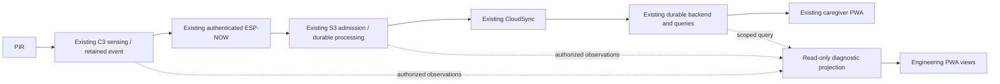

# GS-120 Engineering / Technician Dashboard architecture

Version: proposed v1, 2026-10-12 UTC. Owner: GS-120; delivery GS-122;
implementation GS-124; validation GS-125; diagnostic requirement GS-65.
**DESIGN_APPROVAL_REQUIRED. No production implementation authorization.**
Audited committed baseline: `77e29d44c57f0851f78358049c288323c985d2e7`.
Context preflight PASS, `2026-10-11.001`. Read canonical requirements first;
this document is an IMPLEMENTATION_DESIGN proposal, never a second requirements master.
Latest Jira intake is preserved in
`docs/exec-plans/evidence/engineering_dashboard_20261012/JIRA_INTAKE.json`.
GS-122/10620, GS-120/10621, GS-124/10622 and GS-125/10623 impose design acceptance.
The campaign user instruction permits this saved design and inactive preparation.

## Executive summary and review decision

Build a bounded, read-only projection of the existing product path. Reuse the
original product EventKey, authenticated NodeHealth/contact evidence, Hub
processing results, durable backend query and caregiver projection. Every stage
requires its own evidence; absent instrumentation produces UNKNOWN. The dashboard
does not ingest, ACK, retry, retire, replay, reclaim or create product events.
Guided installation observes operator-generated real motion through that same path.

Recommended first approval: **R0 inactive host-only preparation**, followed by
**R1 read-only diagnostic projection and seven engineering views** after the
technician access contract is supplied. Local fixture identities prove policy tests
only. **R2 guided installation** requires approved deadlines, acceptance stages and
installation-result retention. **R3 target observation export** requires GS-148
ownership coordination and authenticated telemetry transport. Privileged controls
are deferred until GS-109/GS-143 provides the exact authorized control interface.

Ordinary additive details: isolated UI modules, exact identity join, source labels,
UNKNOWN handling, filter controls, bounded query pagination, reuse of existing
health policy, allowlisted diagnostic codes, deterministic test adapters.
Approval-sensitive choices: grant issuer/technician Home scope and revocation;
diagnostic retention/export privacy; installation timeout and required-stage policy;
authenticated target export and resource budget; any persistent storage or command
contract. None is self-approved here. See OPEN_DECISIONS_AND_BLOCKERS.md.

## Existing capability assessment and modules to reuse

Labels: A available in source; B partial path; C missing; D logs only; E host/HIL only.
Availability does not establish current-head physical or commercial qualification.

| Capability | Class | Existing source / actual limitation |
|---|---|---|
| PIR sampling and event creation | A/D | `firmware/node/sensing/sensing.cpp`, `runtime/node_runtime.cpp`; breadcrumbs/counters do not correlate a specific optical edge to an EventKey |
| Retained events, retry and ACK policy | A | `node/storage/node_store.cpp`, `node/communication/radio/node_radio.cpp`; MAC success is not application ACK; cumulative counters are not per-event receipts |
| NodeHealth v1/v2 | A/B | `common/shared/include/gs/protocol.hpp`; separate best-effort sequence, not a durable event; backend export absent |
| AEAD, registry and physical/logical mapping | A | Node/Hub `target/*/*security_link.cpp`, common security and Hub commissioning registry; protected identity never leaves custody |
| Hub liveness | A/B | `hub/runtime/hub_runtime.cpp` authenticated contact lease and profile; cloud freshness cannot substitute for this local contact age |
| Hub event observation | D | `hub/runtime/hub_event_log.hpp` exact-key log after processing plus target adapter RX RSSI/channel; safe export absent |
| Hub persistence and reducer | A/B | `hub/storage/*`, `hub/runtime/*`; GS-148 active writer and qualification gaps, no dashboard changes permitted |
| CloudSync | B/E | `hub/cloud_sync/*`, S3 HTTPS adapter; original-key host flow exists, active authenticated production deployment incomplete |
| Durable backend commit/query | A/B | `backend/ghar_sajag/durable_commit.py`, `durable_api.py`, `sqlite_events.py`; real file transactions, fixture trusted middleware; commercial authenticator/deployment absent |
| Fleet, battery, support counters | B | `fleet.py`, `battery.py`, `operations.py`, `queries.py`; operational reference models, no live joined NodeHealth API |
| Caregiver frontend | A/B | `frontend/public/app.mjs`, `frontend/src/platform/index.mjs`; backend-first development app, not technician dashboard |
| Simulator | E | `tests/support/host/simulator/*`, `tools/sim/pwa/*`; some lab routes have synthetic contact, no RF/optical proof |
| Full-product software harness | E | `tests/python/run_full_product_p0_e2e.py`, C++ host stack and Chromium; product_status=PARTIAL despite scenario PASS |
| Technician permission and API | C | `identity.py` has OWNER/CAREGIVER/INSTALLER read roles but no READ_DIAGNOSTICS; unknown permission currently falls into read policy, so never call it with a new permission without an explicit implementation |
| Guided installer results | C | No production exact-key installation session/result API |
| Physical runner | E | `tools/hil/gs130_board_hil.py`, `gs130_motion_hil.py`; default NOT_RUN, GS-114 observation/reset and replay-fence NO-GO |

Paths in tables are relative to `code/`. Source inventory and interface matrix
provide exact symbols and hashes. Existing progress documents/older wrappers are
historical references. GS-65 requires inspection of identity/RF/ACK/retry/queue/
health/power/routine state; unexported metrics remain explicitly unavailable.

## Proposed architecture

The dotted observation export is proposed and unavailable on deployed hardware.
The production line is unchanged. No new product-event table, durable firmware
schema, ESP-NOW packet, timer, Node wake, cloud receipt or completion authority.
Default diagnostics remain disabled until an approved verified principal/grant
resolver exists. Failed diagnostic export drops diagnostic records and increments
a diagnostic gap counter; it cannot withhold an existing ACK or change durability.
Observe through existing single owner tasks; do not query flash from radio callbacks.

## Diagnostic event model and versioned interfaces

Proposed `DiagnosticEvent` schema v1 (separate from Node wire schema 3):

| Field | Type / required | Source and constraint |
|---|---|---|
| schema_version | integer 1 / required | Diagnostic projection codec; reject incompatible major version |
| home_id | string / required | Server-resolved authorized Home, never trusted from telemetry |
| observation_id | bounded opaque string / required | Producer instance + observation ordinal; distinct from EventKey |
| category | PRODUCT / TRANSPORT / SYSTEM / required | Allowlist; product row references existing event only |
| stage | enum / required | sensor, node_created, radio_tx, hub_rx, hub_validated, hub_persisted, rules_processed, backend_queued, backend_committed, dashboard_received; ACK/retirement additional transport rows |
| result | PASS/WARNING/FAIL/UNKNOWN/NOT_APPLICABLE / required | Evidence-specific, not inferred from later success |
| provenance | object / required | producer, source symbol, source/image/config fingerprint, environment=HOST_SIMULATION/TARGET/BACKEND/BROWSER, measurement type and trust boundary |
| event_key | object / optional | Unmodified physical_device_id, logical_node_id, origin_session_id, event_sequence; required for event-stage correlation |
| transport_session_id | decimal string / optional | Current authenticated radio session, never overwrite original event session |
| enrollment_generation / owner_epoch | decimal strings / optional | Existing trusted registry provenance; missing stays UNKNOWN |
| kind / location | bounded strings / optional | Immutable product spelling/location, redacted by approved scope; DOOR_CLOSED is actual source spelling |
| observed_at / occurred_at | integer epoch seconds / optional | Observer vs occurrence remain separate; clock trust and uncertainty accompany time |
| monotonic_ms / clock_domain | decimal string + bounded ID / optional | Only compare within same observer boot/session |
| reason_code | allowlisted enum / required | Empty/unknown reason explicit; never raw exception/credential text |
| metrics | bounded allowlisted map / optional | RSSI/battery/counts/queue depths with unit, direction, availability and sample age |

All identifiers/time counters crossing JavaScript use exact strings when they can
exceed Number.MAX_SAFE_INTEGER. Existing CloudSync request bytes/types remain
unchanged; the diagnostic projection is a new separate versioned consumer codec.
Backend `_identity` accepts positive integers below 2^63, while C++ EventKey is
uint64: do not broaden that contract or round identifiers. The current supported
backend range is reported explicitly, and out-of-range identity is unavailable.
Structured Node EventKey fields must be joined with the registry's physical ID
after authenticated admission, not by guessing from `source:session:sequence`.
The canonical length-prefixed physical key and backend `evt_` hash are different
identifiers. The API returns both mapping fields where authorized. Home is part
of every query/join; replacement physical identity and generation stay separate.

`DeviceHealthSnapshot` contains identity/location/capabilities, observed-at and
source age, firmware/config only when verified, latest authenticated contact,
latest NodeHealth sequence, battery mv/percent validity, measured directional RSSI,
association state, current radio session, original latest-event identity, counters
and errors. Each optional field has availability=OBSERVED/UNSUPPORTED/UNKNOWN/
STALE. NodeHealth is not a business event and must not create caregiver activity.

`TransportObservation` adds EventKey when available, attempt ordinal, actual MAC
result, ACK class and Node authenticated receipt/retirement result as distinct
fields. A NodeHealth counter increment can describe an interval; it cannot prove
which event got ACKed. Boot changes/counter wrap reset baselines instead of showing
negative loss or inferred packet percentages.

`InstallationTestSession` contains authorized Home/actor, session ID, immutable
expected device manifest/version, policy ID, per-step attempts/deadlines/evidence,
explicit result and expiry. `InstallationTestStep` contains exact physical + logical
Node + generation + room + kind, required stages, arming cursor and candidate key.
Schemas are proposals; installation persistence/retention remains unapproved.

## Exact event trace and evidence provenance

| Stage | Permitted evidence for PASS | Current path / required instrumentation |
|---|---|---|
| Sensor triggered | Exact optical-input observation bound to event creation | PIR counters/logs alone insufficient; explicit edge-to-key binding missing |
| Node event created | Successful NodeRuntime::record exact identity | Runtime exists; exported per-event breadcrumb missing |
| ESP-NOW transmitted | Exact outbound frame/attempt owner result | Node adapter / radio stats; MAC callback alone does not prove Hub RX |
| Hub received | Actual receiver observation of the same frame/key | Target adapter log; unauthenticated RX cannot prove validation |
| Hub validated | Current-session AEAD + physical registry admission for original key | HubSecurityLink and authenticated_radio_message_callback; export missing |
| Hub persisted | Durable processing result tied to existing accepted key | run_state_once durable result; backend presence does not prove local commit |
| Rules processed | Reducer application result for key, including duplicate/no-op | ProcessResult state_changed/signals; no incident is not rule failure |
| Backend queued | Existing immutable outbox contains original event | HubJournal/CloudSync observation; never new dashboard queue |
| Backend committed | Actual durable transaction row with exact key/Home/payload/provenance | DurableEventCommit and SQLiteEventMap; fixture proof labeled host, not live target |
| Dashboard received | This browser parsed/displayed exact authorized query row | View-local evidence; not every caregiver device or push delivery |
| ACK / event retired | Hub send and Node verified ACK/retained removal separately | Existing runtime paths; Hub send SUCCESS alone cannot prove Node retirement |

Trace assembler joins only explicit identity/provenance. Never promote prior stages
from downstream evidence; never downgrade a known commit because an ACK was lost.
Conflicting same-key observations produce a conflict warning and retain sources,
not last-write-wins success. Duplicate attempts appear under one logical event;
different Homes, physical Nodes, origin sessions or sequences remain separate.
Latest room configuration cannot relabel historical location. Order by observation
cursor within producer; show occurrence uncertainty and boot domains. Unknown or
overlapping clocks cannot establish causal latency. Stage order is conceptual,
not a fabricated timestamp order. Unsupported stage is UNKNOWN with a reason;
NOT_APPLICABLE requires an explicit policy, e.g. no optical PIR stage for heartbeat.

Executed host/API preparation confirms that the Node-local key `room:10:1`
becomes the Hub-qualified canonical key `p6:devicen4:rooms10q1`. Correlation
preserves logical `room`, original session 10 and sequence 1 and requires the
authenticated binding to physical `device`; local and qualified strings are not
literally equal. This observation is host evidence, not a new identity contract.
The target adapter's original `hub_received_at=0` is untrusted time. A backend
query fallback may show backend receipt time as occurrence; the diagnostic view
must preserve the raw original field and mark its uncertainty rather than label
the projection fallback as an optical timestamp.

## Health, communication and fault classification

Reuse GS-40 deployment policy: default heartbeat 300 s, contact lease 910 s;
trusted legacy_60 profile 190 s and legacy_120 310 s. Online includes equality
at the lease boundary. Unknown profile/contact/clock or stale Hub feed => UNKNOWN.
Authenticated product traffic/rejoin refreshes contact without becoming a fake
heartbeat. Report `last_contact` separately from `last_health` and `last_product_event`.
Hub backend heartbeat lease is a distinct OperationsService reference default
190 s; it does not prove S3 power loss or local Node liveness.

Proposed aggregate precedence: observed active fault ERROR; valid lease expired
OFFLINE; explicitly observed commissioning COMMISSIONING; approved warning
WARNING; current authenticated contact without known fault HEALTHY, labeled
communication health rather than total sensor qualification. Missing trusted
inputs UNKNOWN. Error-code freshness and severity mapping need review. Existing
canonical low-battery policy is reused; no arbitrary RF threshold is introduced.
RSSI is directional per received frame; firmware payload RSSI can describe another
direction. Raw -90 dBm alone is OBSERVED_RSSI, not proof of WEAK_RADIO.

| Category | Observed evidence / wording | Inference / next check |
|---|---|---|
| NODE_OFFLINE | Trusted contact age exceeds lease | Node may lack power/range; inspect association and last Hub observation |
| WEAK_RADIO | Approved threshold policy and measured sample set; otherwise only RSSI observation | Check placement/interference; no claimed loss percentage |
| ASSOCIATION_FAILURE | Exact-node rejoin/registry error | Inspect approved enrollment; no automatic recommission |
| ACK_TIMEOUT | Exact attempt has no verified application ACK by existing runtime deadline | ACK loss, link or Hub storage possible; inspect Hub durable result |
| EXCESSIVE_RETRY | Approved interval/rate and counter baseline | Counters alone say retries observed, not excessive |
| DUPLICATE_EVENT | Existing exact-key duplicate outcome | Expected lost-ACK recovery may explain it; one caregiver effect |
| HUB_STORAGE_FAILURE | Exact existing failure/RPF stage code | Underlying physical errno/root cause UNKNOWN; preserve fail-closed |
| BACKEND_OFFLINE | Network/TLS/API error from actual cloud attempt | Distinguish internet, authentication, server and invalid reply |
| BACKEND_QUEUE_GROWING | Comparable two queue samples in same domain | Not proof of capacity failure; inspect commit/retry status |
| CONFIG_MISMATCH | Verified desired vs applied fingerprint mismatch | Publishing desired config is not applied success |

Do not calculate packet loss without paired send/receive denominators; latency
without trusted matching clocks; average/trend without bounded valid samples and
direction. Separate observed symptom, inference, severity and safe next action.
Routine-learning status is a sanitized reducer/window summary, never resident
history dump, and uncertain recovered state stays explicitly uncertain.

## Backend/API design and authorization

Follow existing `/v1/homes/{home_id}` routing. Proposed endpoints:

| Endpoint | Request / response | Source / permission |
|---|---|---|
| GET diagnostics/overview | no query; health/capabilities, source ages, gaps | Fleet + scoped observation snapshot; READ_DIAGNOSTICS |
| GET diagnostics/events | cursor, limit <=100, device, zone, kind, result; rows + next cursor + gap | Bounded diagnostic projection references; READ_DIAGNOSTICS |
| GET diagnostics/trace?event_id= | exact opaque existing event ID; key mapping + stages | Home-scoped durable query and observation join; READ_DIAGNOSTICS |
| GET diagnostics/devices/{id} | exact installed device; snapshot and bounded recent observations | Trusted fleet/registry view; READ_DIAGNOSTICS |
| GET diagnostics/communication | bounded latest contact/cloud/queue data with ages | Existing transport and cloud observations; READ_DIAGNOSTICS |
| POST installation-tests | manifest version + approved policy; session | Separate INSTALLATION_OBSERVE grant and approved result policy |
| POST installation-tests/{id}/steps/{step}/arm | expected version, idempotency key; armed deadline/cursor | Observe only; no Node control; same grant |
| POST installation-tests/{id}/steps/{step}/retry | expected version; new attempt, prior evidence retained | Same grant; cannot reset a passing/terminal session silently |
| GET installation-tests/{id} | scoped session result and gaps | Same grant and READ_DIAGNOSTICS |

No diagnostic ingestion from browser clients, no raw-log streaming endpoint and
no restart/recommission/test/identify endpoint in the MVP. Refresh is an authorized
read, not a device command. Identify, test injection, restart and recommission are
disabled with `supported authenticated control path unavailable` until separately
approved. Existing HIL controls cannot become product commands.

Errors: missing verified principal 401; denied/expired/revoked grant or Home scope
403 before data lookup; scoped unknown ID 404; malformed/duplicate/unknown filter
or unsupported codec 400; stale step/manifest or conflicting operation 409;
cursor expired 410 with explicit diagnostic gap; unsupported feature 501;
trusted source unavailable 503 with typed reason and no fabricated healthy data;
bounded request/rate exceeded 429. Return no foreign-Home existence details.

Security proposal requires GS-109/GS-143 approval: verified principal resolves
actor + allowed Home + explicit READ_DIAGNOSTICS grant + expiry/revocation/epoch.
Caregiver/Owner generic `read` grants do not imply diagnostics. Never accept actor,
role, Home grant or verified flag from client headers/body/QR/MAC. Existing
X-Actor-Id is development-only; no new authenticator is selected. Recheck grant
on every request and before result export, stop polling/clear state on 401/403,
Home switch, logout or ownership change. Same-origin deployment, CSRF for session
mutations, TLS, bounded rate and audited allow/deny/result operations follow the
approved platform contract. Audit captures actor/domain/action/time/result/subject,
never token, private/wrapping key, raw packet or resident payload. Do not depend
on unbounded in-memory audit as production retention. Allowlist fields on server;
render with textContent/escaped templates; do not spread arbitrary health dictionaries.

## Seven screens

1. **Installation Overview:** Home/Hub identity and source freshness; six expected
   Node rows with room, contact health, firmware provenance, battery availability,
   directional RSSI, last health/event; explicit untested/offline/unsupported counts.
   Show unresolved backend/trust and physical qualification separately.
2. **Live Events:** virtualized bounded product/transport/system rows; device, room,
   kind and status filters; pause/resume display without pausing product processing;
   cursor-gap banner, timestamp uncertainty, exact-key trace link, stale feed label.
3. **Event Trace:** ten conceptual stages plus ACK/retirement; evidence, observer,
   environment, time uncertainty and reason per stage; original key copy; missing
   evidence UNKNOWN; duplicate attempt expansion and observed/inferred explanation.
4. **Device Diagnostics:** physical/logical IDs and generation, room, current session,
   original event identity, NodeHealth schema/counter ages, errors, heap/sleep/power
   fields if available; unsupported firmware/metrics explicit, no fake battery percent.
5. **Communication Health:** separate C3→S3 and S3→backend panels; RSSI direction,
   retries/MAC/application ACK distinction, last contact, channel, actual CloudSync
   connectivity/queue samples/last error; no invented latency or loss percentage.
6. **Guided Installation Test:** expected immutable exact device manifest, policy,
   one armed step and deadline, real stimulus instructions, wrong-node messages,
   intermediate local/backend evidence, retry history and non-pass overall status.
7. **Advanced Diagnostics:** expandable sanitized codes/provenance/capabilities,
   diagnostic-drop gaps, source/profile/validation status; authorized redacted
   export only after retention/privacy approval. Privileged actions disabled.

Use existing frontend platform/API transport and visual tokens after approval;
new feature module `frontend/src/features/engineering/` and server projection
`backend/ghar_sajag/diagnostics.py` are proposed only. Responsive stacked cards,
keyboard navigation and aria status updates; state clear on denied access. Caregiver
routes/data semantics unchanged. Service worker must never cache technician data
as public/offline household-independent content. Refresh reloads actual evidence,
not a previous PASS from localStorage.

## Guided installation state machine

Session states DRAFT → ACTIVE → COMPLETE/PARTIAL/FAILED/CANCELLED/EXPIRED;
step states NOT_TESTED → ARMED → LOCAL_OBSERVED → WAIT_BACKEND → PASS,
or TIMEOUT/FAIL/UNSUPPORTED. Warning is a result, never mandatory-step success.
Before arm: verified grant, exact current manifest and capability, trusted Hub
source, approved timeout/stage policy, and diagnostic cursor fence. Arming is
observation only; it does not mark product motion is_test or suppress safety rules.
Operator is warned that real stimulus uses normal product processing.

Match Home + physical Node + logical Node + original enrollment generation +
room + kind. Require fresh post-arm observation in the same cursor/clock domain;
old delayed backlog or reboot-retained event does not prove a new stimulus merely
because backend upload is recent. If event occurrence is uncertain or cannot be
linked to post-arm creation, step stays non-pass. Capture a single candidate key;
subsequent exact retries/duplicates update that candidate, never satisfy another
device/step. Wrong-node events remain visible and cannot advance state. Re-arm
creates a new attempt/cursor; prior evidence remains immutable. Backend evidence
must match the candidate exact key; local PASS is not backend PASS. Session cannot
COMPLETE/PASS until every mandatory device and required stage has actual evidence.
Unsupported required device blocks completion; optional omission is explicit.
Two concurrent arming operations conflict by version; grant expiry/Home transfer
ends session. Browser refresh reads server state after persistence is approved;
inactive prototype refresh deliberately loses state and shows NOT_TESTED.
No timeout number/retention duration is chosen as product policy here.

## Persistence, retention, budget and overhead

Diagnostic evidence is reconstructible/best effort; correctness storage remains
GS-148-owned. Proposal: RAM-only recent observation window, no Hub/Node persistent
diagnostic writes or new radio messages. Backend event trace references existing
events instead of duplicating payload/history. Installation-result storage and
export retention require separate privacy approval; until then only ephemeral
review sessions, explicitly no durable installation certificate.

Sizing assumptions for review, not approved limits: 256 observation records at
<=512 encoded bytes ≈128 KiB backend/live-browser payload; JS/Python object overhead
and provenance can multiply memory and must be measured. Keep UI <=256 rows and
queries <=100 rows. Candidate 32 compact 128-byte Hub records ≈4 KiB before allocator
overhead; no target exporter is included in the first scope, so actual campaign
target delta is zero. Node delta: zero flash/RAM/wake/radio/persistent writes.
Proposed poll every 5 seconds while foreground with backoff/abort and no overlapping
requests: <=12 requests/minute/session; 100×512 bytes full pages can be ~600 KiB/min,
so use cursor deltas/caps and pause hidden tabs. Five seconds is a review assumption,
not a required liveness/release claim. Bounded append/query complexity O(window);
event query uses existing Home/identity indexes. No flash scan or crypto in radio
callbacks, and diagnostic drops cannot impede product owner tasks. Measure heap,
ACK scheduling, binary delta, CPU and transferred bytes before any target export.

## Simulator and validation design

Reuse GS-130 production C3/S3 driver and LocalProductStack; virtual GPIO, time,
RF delivery and faults are labeled HOST_SIMULATION. Existing JSON request is
submitted to real JsonApi/DurableEventCommit, query and frontend renderer. The
same diagnostic codec/assembler/view renders real authorized observations later;
no simulator-specific UI or fabricated deployed principal. Synthetic edge
evidence cannot satisfy PHYSICAL optical PIR acceptance. Retain current full P0
PARTIAL and historical journal migration FAIL. Mock component demonstrations are
preparation, never production software qualification.

GS-125 matrices enumerate exact positives/negatives/recovery, source layers,
commands and gaps. Unit: identity/schema, auth/Home denial, lease boundary,
retry/ACK/duplicate, clocks, bounded window, invalid input, installation transitions.
Simulation: healthy/offline/recovery, weak-RF observation, delayed/lost ACK,
duplicates, Hub/backend recovery, backlog, boot/rejoin, storage failure, wrong
device, timeout/incomplete/multi-device and unsupported capabilities. Integration:
production adapters, real transaction/reopen/dedupe/conflict, immutable room/time,
actual service-to-browser trace, no false delivery. Playwright: all seven screens,
filters/live cursor/refresh/mobile, access denial and normal caregiver regressions.
After approved implementation execute new tests plus all prior affected suites.

Reuse `validation/suites.json`, component_gate receipt executor and existing
MASTER_TRACEABILITY/source/physical catalogue. Proposed stages diagnostic-unit,
diagnostic-simulation, diagnostic-api and diagnostic-browser enter backend/PWA/
contract/fast/release as applicable; browser remains release-only plus explicitly
executed affected-UI loop. Verify missing markers/zero counts/failure propagation/
fingerprints via existing framework meta-tests. Inactive preparation is not a
registered production acceptance stage. No alternate validation framework and
no release-gate-final/unconditional validation-fast in this campaign.

## Physical HIL strategy

Reuse existing board/motion runners, physical case IDs HIL-A01–A08 and C8-P1–P9,
GS-114 fixture/profile/evidence. Add mapped dashboard observations to the same
case catalogue after approval; do not create an automatic port-opening runner.
Require exact disposable C3/S3 N16R8 identity, source-matched running images,
AM312 optical stimulus and approved reset-safe observation plus exact operations.
Saved image hashes are not flash readbacks. The current C3 USB_UART_CHIP_RESET
and S3 replay-fence failure remain unresolved physical NO-GO. No UART/USB
enumeration/access, flashing, reset, erase, re-enroll or power operation is allowed.
Default hardware-free runner checks can prove NOT_RUN behavior only.

Physical sequence, after separate approval: identify running source/profile safely;
observe genuine optical edge → exact C3 creation → authenticated S3 validation
→ durable result → verified Node ACK/retirement → authorized real backend commit
→ engineering and caregiver views. Missing source/stimulus/identity/evidence is
BLOCKED/NOT_RUN. Lost ACK/reset/storage-fault physical campaigns require separate
explicit operation approval and protected-state preservation. Simulator PASS
never substitutes. HIL_ACCEPTANCE_MATRIX.csv lists prerequisites and exact assertions.

## Implementation phases, ownership and acceptance

| Phase | Modules / dependency | Validation / exit |
|---|---|---|
| R0 preparation | This proposal, fixture-only test support; no production imports/callers of prototype | Draft-model tests clearly labeled; design ready for review |
| R1 schema / projection | New diagnostics module and existing query adapter; approved verified grant seam | Unit+actual service simulation+API→browser E2E, backend/PWA regressions |
| R1 UI | Engineering feature, read-only authorized routes, seven views with unavailable workflow/controls | New browser tests + caregiver regression/mobile/access denial |
| R2 installation | Approved exact manifest/policy and session store | Wrong device/old key/retry/timeout/all-device/no-false-PASS/reopen tests |
| R3 target export | GS-148-coordinated owner task and approved authenticated export budget | Node/Hub/contract/board suites, target build/sanitizer and physical mapping |
| R4 qualification | Existing GS-130 runners and GS-114 source-matched fixture | Separately authorized physical evidence and later real release candidate |

Exclusive campaign files: architecture/evidence/handoff, new fixture-only support.
Future shared edits (`code/Makefile`, `suites.json`, MASTER_TRACEABILITY,
SOURCE_FEATURE_INVENTORY, PHYSICAL_HIL_CATALOGUE, canonical status docs) must be
coordinated against the completed GS-148 checkpoint before integration. Do not
copy its uncommitted persistence/runtime/CloudSync files or modify canonical index.
Isolated branch is based on clean remote 77e29d4; current GS-148 changes remain
absent and explicitly listed in the intake snapshot. No canonical merge while
GS-148 writes. These branch documents record proposed status only.

MVP acceptance: separately approved scoped design; trusted diagnostic access and
Household isolation; accurate source/UNKNOWN labels; exact EventKey; bounded
read-only screens; meaningful executed unit/simulation/API/browser evidence;
permanent registry/traceability; no product regressions. Guided installation and
target physical claims need their additional approvals/evidence. Deferred:
device control, raw log streaming, historical analytics, credential technology,
retention duration, RSSI thresholds, storage/CloudSync authority and live physical
qualification. GS-120 is proposed; GS-124 production BLOCKED_DESIGN_APPROVAL;
GS-125 production qualification BLOCKED; release NOT_RUN/NOT_APPROVED.
