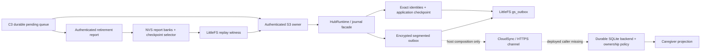
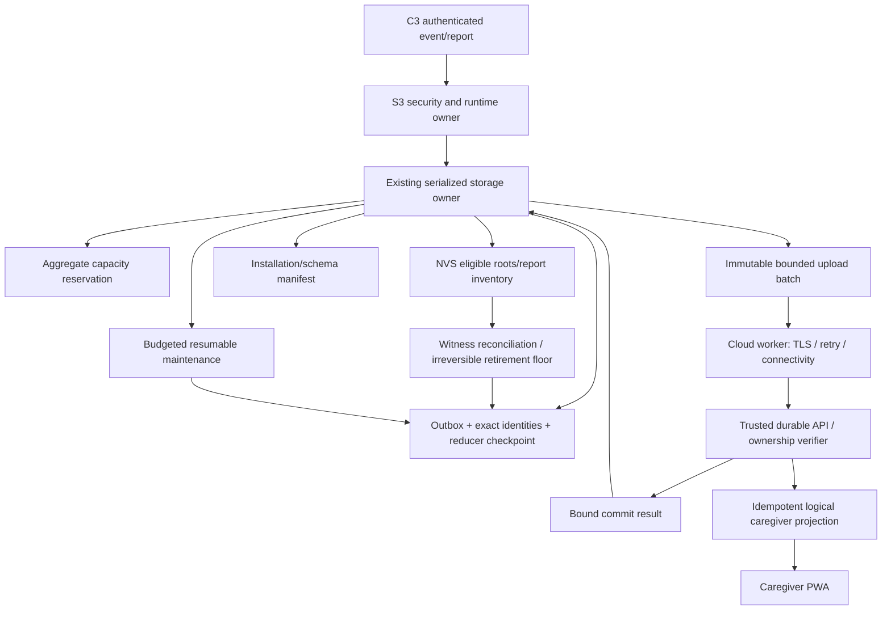
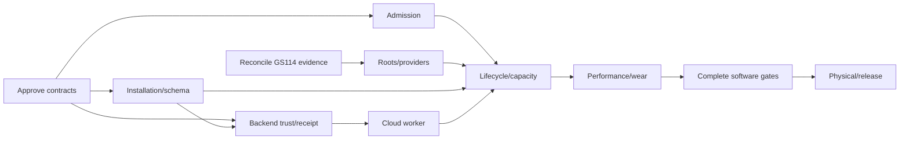

# GS-148 — ESP32-S3 commercial durable-storage architecture review

**Review date:** 2026-10-12 UTC. **Classification:** read-only architectural audit and proposed implementation design; not a product decision, release certificate, or implementation authorization.

**Pinned source:** `e31e8ef6314abcc777eb5979c3d33939cdb7b296`, canonical branch `feature/r1-commercial-baseline`, origin `https://github.com/udaybhan200683/Ghar_sajag.git`. The source baseline is the committed tree, not GS-114's concurrent uncommitted changes and not GS-152. All source citations below refer to this commit.

**Snapshot:** [manifest](SNAPSHOT.txt), [immutable archive](source.tar), [extracted source](source/). Archive SHA-256: `e8be4af1ccf918d354006cd0665e89c537d59381c1706f963512da110ea11491`; archive mode 0444, extracted files 0444/directories 0555. These permissions provide a read-only analysis snapshot, not cryptographic protection against its owner changing permissions. No source edits, builds, tests, flash, serial access, Git mutations, or Jira mutations were performed in this audit. Report and calculation artifacts are outside the source tree.

The archive context preflight returned **INCOMPLETE / LOCAL_GIT_WORKTREE_NOT_FOUND**, exit 1, because a Git archive has no `.git`. The committed context file is `GHAR_SAJAG_CONTEXT_VERSION=2026-10-11.001`. This is not a preflight PASS or an exception permitting implementation. Read-only investigation continued under the user's explicit audit scope. Any later implementation must reconcile the then-current canonical worktree and obtain an actual PASS there. The other session's work must be preserved.

At intake, canonical tracked modifications and untracked GS-114 evidence/build assets existed. They were excluded by archiving HEAD and left untouched. The snapshot does not assert the state of work completed after intake. Prior delivery evidence reports origin matched the starting checkpoint; this report does not claim a newly verified remote delivery or remote HEAD equality.

## Navigation and interpretation

- A. Executive engineering assessment
- B. Verified current implementation inventory
- C. Historical 128-event journal closure matrix
- D. Detailed gap analysis
- E. Recommended architecture and alternatives
- F. Module design and C++ contracts
- G. Persistence, transitions, crash consistency and recovery
- H. Capacity, memory, performance and endurance model
- I. Security and CloudSync contract
- J. R1 and post-R1 scope
- K. Implementation packages, dependencies and effort
- L. Acceptance and regression architecture
- M. Jira mapping and evidence ledger
- N. Decisions requiring approval
- O. Prioritized roadmap and review exit

**Evidence labels:** IMPLEMENTED means source exists; HOST-EVIDENCED means a cited historical run exercised an identified implementation/profile; TARGET-BUILT means a cited image compiled; PHYSICAL means matched actual board/image observations; PROPOSED means this report's recommendation. These labels are independent. No historical PASS is promoted to a fresh execution at this snapshot, and no simulation establishes physical qualification. SOURCE-DERIVED RISK identifies a concrete path needing a reproducer, not a measured failure.

Source path abbreviation **P** means `source/code/ParivarSathi_v1.5.4_PWA_BatteryAnalytics_v3_4_2/`. File paths prefixed P below are exact modules in that directory. [SOURCE_INVENTORY.csv](SOURCE_INVENTORY.csv) records58 principal source inputs with pinned HEAD and individual hashes; it is an analysis inventory, not a replacement for GS-130's canonical exhaustive inventory. [DELIVERABLE_SHA256SUMS.txt](DELIVERABLE_SHA256SUMS.txt) records the package hashes. Product authority is LOCKED decisions → release contract → canonical domain documents → current work state → supporting design → tests/evidence → history → this report.

Primary authority: [project context](source/docs/product/GHAR_SAJAG_PROJECT_CONTEXT.md), [release contract](source/docs/product/R1_RELEASE_CONTRACT.md), [work state](source/docs/product/R1_WORK_STATE.md), [canonical index](source/docs/product/CANONICAL_REQUIREMENTS_INDEX.md), [decisions](source/docs/product/DECISION_LOG.md), [storage/cloud/learning architecture](source/docs/architecture/STORAGE_SYNC_ROUTINE_LEARNING.md), [validation contract](source/docs/validation/MASTER_VALIDATION.md). Existing [lifecycle plan](source/docs/exec-plans/active/R1_HUB_STORAGE_DATA_LIFECYCLE.md) is a supporting proposal. The old [durability handoff](source/docs/DURABLE_STORAGE_EPIC_PAUSE_HANDOFF.md) is historical for worktree, 128-event and legacy-migration status; it must not override the integrated S3 implementation or GS-D005/016.

## A. Executive engineering assessment

### A1. Recommendation

**Finish the current encrypted segmented LittleFS design, rather than replace it.** Keep NVS for bounded security/ownership and retirement control state; keep immutable event bodies, exact identities, reducer checkpoints and local completion evidence in the serialized LittleFS storage owner. Reuse the implemented authenticated publication roots, replay fence, dense completion bitmap and alternate-bank compaction. Add the missing commercial composition, whole-filesystem resource reservation, explicit installation/schema identity, recovery-root inventory, bounded worker scheduling and target qualification.

The old 128-event runtime ceiling is removed on the S3 path. **Sustainable commercial lifetime is not proved or enabled:** production body/identity deletion remains disabled, the identity log has a 1 MiB quota, and actual target event geometry is only 2 MiB inside a 4 MiB candidate filesystem. More flash displaced the exhaustion boundary; guarded host compaction demonstrates an approach to solving it but does not close retention policy, scheduling, reserve, target power-cut or wear acceptance.

### A2. Highest-priority findings

1. **Current physical replay-fence failure is unresolved.** GS-114 logs demonstrate admission closed following report reconciliation/rejoin; they do not prove whether the failure was NVS selection, report reload, application-checkpoint reload, LittleFS publication/readback or runtime binding. New diagnostics distinguish these stages. The prior diagnostic image used an incompatible commissioning/partition profile, so its build is not a valid fixture experiment. Leave GS-114 Part 2D undisturbed and consume its eventual identified evidence.
2. **Real backend durability exists, but commercial target delivery does not.** The real SQLite transaction/idempotency service, strict receipt parser and bounded HTTPS channel are implemented and host exercised. An active S3 CloudSync/connectivity worker, commercial issuer/verifier and trusted deployed composition are absent. The v2 event carries original Node enrollment generation, but the current response/local completion record is not a complete owner/installation/payload-bound receipt contract.
3. **NVS and LittleFS form a consistency protocol, not one atomic transaction.** Selected NVS retirement authority must be authenticated, published as a LittleFS witness, and bound before report ACK or deletion. NVS recovery can choose an older valid selector when another is invalid; the LittleFS fence must forbid retirement regression. Current report staging protects only the selected report bank. Enumerate all recovery-eligible references and prevent reuse until obsolete authority is durably retired.
4. **Source exposes an admission liveness hazard at capacity.** `HubRuntime::run_state_once()` prepares the next exact identity before `journal_.commit()` can return Full. The prepared row pins that ordinal to its key; a different event cannot take it. This is fail-closed rather than data loss, but can obstruct protected events after ordinary capacity refusal. Reserve the entire admission transaction before preparing an identity; specify exact cleanup for definitely uncommitted preparation.
5. **Combined capacity is not established by separate passing fixtures.** The 300-event cloud bridge stores identities in a separate memory fixture. POSIX file-block recovery is not LittleFS allocator recovery. The filesystem must simultaneously fit bodies, identities, completion records, checkpoint replacements, authenticated roots, source/candidate generations, allocator metadata and a protected reserve.
6. **Recovery and catch-up need explicit runtime bounds.** Sorted outbox index insertion can make recovery quadratic; CloudSync repeatedly scans retained bodies; full application checkpoints are written per event. These are acceptable at some measured sizes, but no S3 timing/heap/endurance proof covers the commercial HIGH workload or near-full storage.

### A3. R1 acceptance position

R1 must preserve fresh/current-format durability, authenticated ownership, immutable EventKey, durable-before-ACK, exact retry safety, truthful coverage/time, bounded resources, sustainable reuse and signed FOTA rollback compatibility. GS-D001 permits deferring arbitrary development-era migration; it does **not** permit a finite lifetime admission ceiling, false COMMITTED, or dropping pending safety data. A 72-hour **internet-only** outage is a locked design target, not a guaranteed arbitrary event volume or a Hub-powered-off guarantee.

**Assessment at the pinned baseline:** valuable implementation and host evidence; partial target build evidence; commercial storage lifecycle and CloudSync **PARTIAL**; current-format S3 physical durability, whole-partition capacity/endurance and release approval **NOT PROVEN**. GS-145 remains a distinct current-format gate; GS-148 owns sustainable lifecycle and production cloud closure. This review changes no status.

## B. Verified current implementation inventory

| Component / exact source under P | Implemented responsibility | Evidence and limit |
|---|---|---|
| `shared/include/gs/domain.hpp` | Canonical physical/logical/session/sequence EventKey; immutable origin identity | Host identities exercised; transport session is separate from origin session |
| `firmware/hub/components/storage/journal.{hpp,cpp}` | Shared event codec and journal facade; legacy 128-slot provider route and pluggable S3 backend | Historical classic tests remain valid for that route; do not apply slot limit to S3 |
| `storage/durable_event_outbox.{hpp,cpp}` | AES-GCM frames, authenticated event/completion heads, exact-key index, recovery, replay witness, completion bitmap, alternate-bank body GC | P2-A/B/C host and sanitizer evidence; deletion authorization false in production |
| `storage/outbox_journal_backend.{hpp,cpp}` | Production journal facade over outbox; ordinal is lifetime publication high-water, not retained count | Segmented-runtime host evidence; no new duplicate journal needed |
| `storage/runtime_state_store.{hpp,cpp}` | Exact identity log with original payload digest/minute/owner; 64 KiB application checkpoint; alternate identity generation | Host restore/compaction evidence; 1 MiB identity quota; production deletion disabled |
| `storage/node_retirement_snapshot.{hpp,cpp}` | Authenticated report apply, three NVS banks, exact bank/generation/digest refs; v3 owner binding | Host protocol/retirement evidence; bank protection must cover eligible roots |
| `storage/durable_transition.{hpp,cpp}` | NVS A/B checkpoints/selectors, bounded transition/effect/evidence objects, legacy manifests | Current-domain primitives exist; legacy coordinator incomplete; migration test remains failed in recorded evidence |
| `storage/hub_durability_owner.{hpp,cpp}` | Storage epoch/freshness, NVS recovery, registry ownership, admission readiness | Current fresh-domain integration; unsupported legacy storage stays closed |
| `firmware/hub/runtime/hub_runtime.{hpp,cpp}` | Authenticated ingress, identity-before-body, reducer checkpoint, retry/no-repeat effects, replay bind, retirement eligibility | Existing production-code simulations; capacity refusal preparation risk identified below |
| `firmware/hub/runtime/hub_checkpoint_codec.cpp` | Versioned encoded rule, coverage, activity and power state | 64 KiB cap; does not establish full canonical day/learning product closure |
| `firmware/hub/target/esp32s3/littlefs_segment_store.{hpp,cpp}` | LittleFS 1.20.4 mount without format, sync, atomic temp replacement, actual filesystem occupancy, same adapter for state files | Compiled; POSIX host fixtures do not prove target barriers/allocator/power-cut behavior |
| `firmware/hub/target/esp32/nvs_durable_blob_store.*`, `nvs_durable_key_codec.*` | S3 state-partition access, fixed/bounded keys, readback, may-persist error handling | Reused target provider; no initialization erase |
| `firmware/hub/target/esp32/hub_runtime_adapter.cpp` | Actual S3 owner composition under target conditional; mounts outbox; authenticates reports; reconciles fence before report ACK | Source integrated; physical report-fence path currently blocked |
| `firmware/common/transport/node_retirement_protocol.*` | Authenticated bounded high-water plus complete pending exceptions, fragmentation, report ACK | C3/S3 shared contract; pending set must be complete, never infer missing keys from a partial report |
| `firmware/node/runtime/node_runtime.*`, C3 adapter | Durable pending events, 32-entry bound, generation advances on admission/retirement; retries/reports during awake runtime | Existing Node regression/HIL evidence has exact scope; no battery behavior change proposed |
| `firmware/hub/components/cloud/cloud_sync.*` | Pending discovery, 16 staged requests, 64 volatile retry hints, bounded backoff, completion only after trusted transport result | Host bridge; repeated scans need throughput analysis |
| `firmware/hub/components/cloud/http_backend_transport.*` | Original serialized event verification, v2 generation, strict exact COMMITTED parser | 2048-byte request/1024-byte response; current response is limited |
| `firmware/hub/target/esp32s3/https_backend_channel.*` | Configured CA/hostname HTTPS, opaque authorization, no redirects, bounded I/O | Compiled and fake-IDF host exercised; no production credentials or active caller |
| `backend/ghar_sajag/durable_commit.py`, `durable_api.py`, `sqlite_events.py` | File-backed SQLite FULL-synchronous durable commit; same transaction event, commit, incident/job/notification outbox; exact duplicate payload check | Real SQLite fixture evidence; ordinary development JsonApi is not automatically production durable composition |
| `backend/ghar_sajag/ownership_registry.py`; migrations `009`, `010` | Permanent Hub identity, one active Home, epoch, Node globally fenced generation, commit provenance and audit | Injected trusted-capability tests; actual production proof verifier and transfer completion absent |
| `tools/validation/suites.json`, top-level product `Makefile` | Component/contract registration, board-stack/P0 integration, physical evidence separation | Registry source exists; no gate run in this review |

`storage/` in abbreviated rows above means `firmware/hub/components/storage/`.

### B1. Historical evidence that can be reused, with its actual scope

The [P2-C final evidence](source/docs/exec-plans/evidence/R1_S3_P2C_FINAL_VALIDATION_20261010.md) records 42 mutation boundaries × before/after = **84 interruption checks**, six later-admission cuts, 32 refill/reclaim windows and 3,232 admissions. Six-Node simulation exercised 12 windows/1,440 admissions with 31 pending bodies preserved. HIGH 3,278 events, 6,556 completion regression and 12,000 cumulative identities were separately exercised. It measured POSIX total blocks 49,152→16,384 and event-body blocks 28,672→4,096. Those are real host allocation measurements, not S3 flash measurements. Whole-process RSS 10,344 KiB/ASan 365,068 KiB is not target RAM.

The [P2-D evidence](source/docs/exec-plans/evidence/R1_S3_P2D_CLOUD_VALIDATION_20261010.md) records **300 events, 304 requests, 300 commits, three duplicates, four injected failure modes, zero final pending, 30 critical logical effect sets** against the actual file-backed SQLite service. Bodies and encrypted retries were compared across Hub/backend restarts. Identity bytes were held in a separate memory fixture. Catch-up 138.863 s under compiler load is not network throughput, a 72-hour workload or target endurance.

The [replay diagnostic evidence](source/docs/exec-plans/evidence/R1_GS148_REPLAY_FENCE_DIAGNOSTIC_20261012.md) records 21 new assertions and builds. S3 diagnostic image 1,870,944 bytes, SHA-256 `3a432fa7bd671e91cb6b4f93d437f81b0892aa878ad5e4173e196fb4623f098a`, used the wrong profile for the current fixture; no physical deployment PASS follows. P0 product E2E can have passing assertions/browser checks while **product_status=PARTIAL causes gate FAIL**. Its trusted local adapter is not OIDC/commercial authentication.

### B2. Physical finding reconciliation

Read [GS-114 Part 2B root-cause investigation](source/docs/hw/evidence/BAT_C8_R1_QUALIFICATION/GS114_PART2B_ROOT_CAUSE_20261012.md) and Part 2C deployment plan in the same directory together with Jira comments 10504–10507. There are three independent observations:

- C3 observed `USB_UART_CHIP_RESET`; setting DTR/RTS after `os.open` may be too late. This is a fixture-observation risk, not a proven storage cause.
- S3 reported replay-fence failure/admission closed following authenticated report/rejoin. There is no demonstrated exact EventKey→durable commit→authenticated ACK chain for that failed run.
- A later diagnostic image was built with `GS_HIL_COMMISSIONING=OFF` and development `gs_journal` geometry, unlike the fixture's commissioning ON / `gs_outbox` / `gs_state`. A full bundle would also rewrite bootloader/partition/OTA state. That mismatch explains why that image is unsuitable as an experiment; it does not identify the original replay-fence cause.

Do not attribute the physical failure to migration, repair storage, reset epochs, rerun factory initialization or change GS-114 policy from this report.

## C. Historical 128-event journal closure matrix

| Original issue | Classic ESP32 implementation | Current S3 result | Closure classification / remaining work |
|---|---|---|---|
| 4 MiB total flash constrained OTA/storage | Two 1,966,080-byte OTA slots, 128 KiB `gs_journal`; limited image margin | N16R8 approved, two 4 MiB OTA slots, 4 MiB outbox + 256 KiB state candidate | Hardware direction solved; commercial layout and actual board/image qualification open |
| 128 slots/events lifetime journal | Slot ordinal tied to bounded retained array; completed receipts did not automatically reclaim journal | Outbox journal uses published ordinal and retained sparse bodies; host admits beyond 128 | Structural ceiling removed on S3; no claim all classic routes changed |
| Completed events still exhaust lifetime | Append-only history consumed available slots | Dense completion bitmap, guarded mixed-body and identity generations implemented | Host reclamation/reuse proved for cited windows; production deletion disabled; sustainable lifetime remains open |
| Reducer needs all retained history | Recovery coupled to journal replay | Durable application checkpoint plus replay after its boundary | Host current-format decoupling implemented; complete product learner/day state and target cuts need coverage |
| Duplicate suppression disappears with body deletion | Exact body/slot served as duplicate evidence | Independent exact identities plus authenticated Node retirement floor/pending exceptions | Host implementation substantial; all recovery roots and incarnation/ownership transitions need proof |
| All lifetime receipts grow | Per-event receipt stream/ordinal-span risk | Completion replacement root, dense retained-body bitmap and generation-bound head | Host >5,472 cumulative receipts and repeated windows; target wear/allocator not qualified |
| Fixed NVS entry/byte budget | Historical ledger for classic journal/migration | Bodies/identities move to LittleFS; 256 KiB state is bounded control store | Old NVS budget is obsolete for S3; actual coexistence/key/page budget needed |
| Offline event rejection | Capacity Full rejects; Node must retain until valid ACK | Larger finite pending buffer, reserved body capacity, exact retry | Capacity boundary moved; no arbitrary outage promise; full transaction reserve and overflow policy missing |
| Legacy-domain migration regression | `clean migration commits` fails when helper writes registry-domain events into legacy selected root | S3 current-format path explicitly refuses unsupported legacy domain | Separate historical FAIL, not root cause of current fixture replay failure; GS-D001 allows deferred migration but gate treatment requires an explicit decision |
| Replay after retirement / lost ACK | Increasing slot count alone cannot solve stale retry | NVS selected report→LittleFS witness→runtime bind→report ACK | Correct protocol direction; recent physical failure remains independently unresolved |
| Flash reuse after reclamation | Erase/reset could hide limit and destroy evidence | Verified alternate bank cutover; preserve ordinals/payload; exact cleanup | Host anti-ABA approach implemented; physical torn erase/GC cuts and all root pins open |

History at the pinned branch includes `bd9dcdf` segmented slice, `d8f1ae3` completions, `396d78e` checkpoint/bounds, `9dbbb72` guarded lifecycle, `7a457c3` incremental completion, `6462a83` replay-fence/identity eligibility, `4f87b67` mixed reclamation, `0b7720a` final safety, `ed6cffc` canonical integration and `cbbf12d` diagnostics. Original evidence often names pre-integration hashes/worktrees; preserve those as provenance and use canonical HEAD for future work. The source inventory, rather than branch recency, establishes what is present.

## D. Detailed gap analysis

| ID | Verified fact or source-derived risk | Consequence | Owning scope / required closure |
|---|---|---|---|
| G01 | S3 defaults select development table without `gs_outbox`/`gs_state`; candidate override exists | A successful build can produce a profile that cannot run the intended storage composition | GS-148/GS-145: explicit build manifest, geometry self-check, no automatic format/repartition |
| G02 | Active target CloudSync worker/caller and STA/ESP-NOW coordination absent | Connected Hub does not yet deliver continuous commercial near-real-time sync | GS-148 P2-D / GS-137; trusted deployment prerequisite |
| G03 | Issuer/verifier/claim adapter unresolved; trusted capabilities injected by tests | Authenticated ownership policy is not commercial authentication | GS-109 + GS-148; no header/MAC/QR substitute |
| G04 | Response/local completion only exact EventKey/status/duplicate; no full installation/provenance binding | Cannot safely generalize receipt across replacement, transfer or changed owner epoch | GS-148/GS-132/137: approved trust contract and persisted context |
| G05 | Body and identity deletion disabled; target identity compaction caller absent | Finite storage eventually closes admission despite successful upload | GS-148 P2-E/F / GS-136/138; policy approval and qualified maintenance |
| G06 | Outbox reserve covers logical body allowance; body GC checks real free space; identity GC estimates candidate bytes + reserve without equivalent block/root ledger | Simultaneous near-full generations can deadlock maintenance or fail after partial staging | GS-138: aggregate reservation and target allocation ledger |
| G07 | Identity prepared before body capacity check; prepared identity persists at high-water+1 | A refused ordinary key can pin next ordinal and block a different protected key | GS-148/GS-138: deterministic reproducer and reservation/abort design; no confirmed board failure claim |
| G08 | NVS chooses highest valid selector whose checkpoint matches; target staging mask protects only selected report bank | Old recovery candidate's referenced report may be overwritten; silently treating an older selector as safe is unjustified | GS-134/136: enumerate eligible roots; compare witness floor before selection/cleanup; fail closed on unresolved authority |
| G09 | Replay-fence publication can fail and close admission; physical failing stage unknown | GS-114 qualification currently blocked; could be valid fail-closed detection or target defect | GS-114 evidence owner; GS-148 software owner only after specific diagnosis |
| G10 | PSRAM indexes reconstructible but sorted insert and cloud repeated scans scale poorly | Boot/catch-up may exceed latency/watchdog/radio budget | GS-138: target timings and bounded iterator/bulk indexing if required |
| G11 | Full rule checkpoint every event; rule `evidence_ids.push_back` grows inside a window; checkpoint cap64KiB | Checkpoint can hit size cap before outbox; high metadata write amplification | GS-148 shared routine owner: bounded semantically sufficient evidence, approved product state model; never silently truncate needed evidence |
| G12 | Current target passes Hub received time 0; full payload digest includes reception fields | Future trusted-clock retry must recover original admission context, not generate a different immutable payload | GS-148 contract test; chronology/coverage owner must resolve clock integration |
| G13 | Storage epoch/key domain exists; complete installation incarnation/owner-epoch envelope and safe turnover policy absent | Reset/replacement/stale receipt handling incomplete | GS-132/GS-109/GS-148; preserve GS-D032 isolation |
| G14 | Supported persistent schema/rollback compatibility manifest not complete | Signed application rollback could encounter newer persistent data it cannot read | GS-132 + FOTA owner; backward-readable epoch required before marking OTA valid |
| G15 | Historical focused evidence not full current commercial gates; target physical cuts/wear missing | Cannot approve release | GS-116/130/139/145/148; mapped evidence required |
| G16 | SQLite atomic logical effects exist; provider delivery capability not universally idempotent | External side effects need independent idempotency contract | GS-137 backend notifications; exactly one logical caregiver effect, retries may generate multiple network deliveries |
| G17 | New late pending events from revoked Node generation rejected; transfer completion blocked | Pending disposal/revocation can pin capacity or leave data undeliverable | GS-D032 product decision; no timeout-based deletion or reparenting |

**Verified protective behavior:** mount/init does not erase; uncertain writes fault closed; encrypted records/authenticated roots preserve original ordinals; selected corrupted compacted body bank has no obsolete-bank fallback; missing checkpoint/body beyond replay boundary fails; exact conflicting payload is rejected; HTTP202/transmit does not complete; pending bodies survive retry-hint eviction. Preserve these properties when closing gaps.

G08 is nuanced: an invalid newer selector can be an expected interrupted publication, while a lost/corrupted previously authoritative selector is different. Existing bytes alone may not distinguish them. A newer authenticated LittleFS witness provides an irreversible lower bound. Do not label every older-selector choice a vulnerability; demonstrate complete cross-store states and prove no retired identity/body can be resurrected. `RuntimeStateStore::compaction_authority_matches()` already permits a later authenticated replay generation, requiring exact bank/digest only at the same generation; do not introduce redundant exact-generation rebinding for every report.

## E. Recommended target architecture and alternatives

### E1. Current composition



The architecture already separates event durability from reducer recovery and Node replay retirement. The dashed edges are composition gaps. It is not necessary to introduce another journal, broker or per-event NVS ledger.

### E2. Proposed composition



**One writer** owns all persistence transitions. Cloud workers hold immutable bounded copies, never runtime/outbox mutable references. Maintenance owns a source-generation lease and blocks conflicting mutations only for necessary steps; it yields between bounded chunks. The security owner remains responsible for authenticated frame acceptance and ACK sealing. Do not put multi-second TLS calls in that owner.

### E3. Alternatives and tradeoffs

| Decision | Option | Reliability/recovery/security | Wear / memory / complexity | R1 risk and recommendation |
|---|---|---|---|---|
| Event store | Existing encrypted segmented LittleFS | Existing authenticated heads and corruption checks; target filesystem cuts still needed | Reconstructible indexes; filesystem metadata amplification; moderate closure work | **Preferred**: preserves proven modules and tests |
| Event store | Raw flash circular journal | Precise physical allocation; must design sector validity, torn erase, bad blocks and anti-ABA from scratch | Potential lower amplification; compact RAM; high bespoke complexity | High R1 risk; post-R1 only if measured LittleFS cost unacceptable |
| Event store | All event blobs in NVS | NVS handles page recovery, but many keys and blobs, aggregate event lifecycle still needed | Per-key/entry overhead and heap; expensive lifetime inventories | Reject for current bodies; retain bounded control state in NVS |
| Event store | Embedded SQLite on Hub | Familiar transactions but backend already uses SQLite; target dependency/flash/RAM recovery is new | Larger footprint and integration; index/write cost | Unnecessary R1 redesign |
| Checkpoint placement | Existing NVS control + LittleFS state | Needs explicit cross-store witness/floor protocol; useful independent authenticated authority | Bounded NVS, current tests reusable | **Preferred** after root inventory; do not pretend atomic |
| Checkpoint placement | Move every control root to one filesystem manifest | May simplify selection but filesystem remains multi-object and key custody separate | Migration/recovery and security changes | Possible future simplification; no demonstrated R1 need |
| Reducer persistence | Full snapshot per event | Conservative ACK semantics and simplest replay | High write/CPU cost; bounded 64KiB | Keep initially; bound state and measure. Optimize only without relaxing ACK |
| Reducer persistence | Snapshot every k events + replay | Body journal can support recovery; needs explicit durable effect intents and replay proof | Lower writes; more replay/effect complexity | Post-R1 unless endurance requires R1 change; GS-D023 still mandatory |
| Completion | Existing compact local record + bound trusted result | Safe if tied to exact original request/domain; receipt independence currently incomplete | Low per-event bytes; reuse bitmap | **Preferred** with contract extension; no new unbounded receipt DB |
| Completion | Signed portable backend receipts | Durable audit across transports; offline independent verification | Signature/key rotation/schema/bytes and deployment work | Choose only if product/security requires independent receipts |
| Identity retention | Exact identities until authenticated monotonic retirement | Handles arbitrary pending exceptions; digest is accelerator, exact key proof remains | Bounded only when reports and GC progress | **Preferred**; no time-only expiry |
| Identity retention | Sequence floor alone | Unsafe when admission gaps/pending reports exist | Small memory | Reject unless same owner/session complete pending-set proof is included |
| GC | Existing bank copy and authenticated root | Simple old/new selection; no selected-corrupt fallback; clear crash oracle | Copy live set, temporary space, radio stall risk | **Preferred**, early/resumable scheduling and aggregate reserve |
| GC | Per-segment incremental manifests | Lower workspace and work per operation | More root references, liveness bookkeeping and cuts | Future if measured bounded bank copy fails budgets |
| GC | In-place deletion/overwrite | Hard to preserve old committed generation across cuts | Less temporary space; high corruption/ABA risk | Reject for R1 |
| Capacity | Increase outbox partition into spare flash | More outage runway; same identity/lifetime/policy issues | Layout/upgrade/asset budget changes | Conditional after quantitative approval; not lifecycle closure |
| Data density | Dictionary IDs / compact binary / eligible summaries | Can reduce duplicated physical/logical/location fields; must retain exact EventKey and original ownership | Better density but new persistent/wire format and semantic approval | First measure current HIGH; no unapproved substitution of exact safety events |

A single serialized owner with chunked maintenance is less complex than concurrent readers/writers with fine-grained locks. Its worst-case latency must be measured, not assumed. Reconstructible RAM indexes may change without changing durable authority; persistent record redesign should be the last optimization step.

## F. Module ownership, interfaces and storage-provider contracts

### F1. Ownership map

| State | Authoritative owner and location | Other consumers |
|---|---|---|
| Node pending EventKey/body and retirement high-water | C3 NodeRuntime durable recovery store | Hub sees authenticated reports; never decides Node pending set from time |
| Active enrollment slot/generation/binding | Hub security/registry owner and authenticated persisted registry | Storage admission validates immutable ingress owner |
| Installation/Home binding | Trusted backend ownership registry; proposed matched local installation manifest | Sessions/credentials/storage bind to exact accepted epoch; no local reset authorization |
| Event accepted ordinal/body | Authenticated LittleFS publication head or selected body lifecycle manifest | Reducer, CloudSync, GC; volatile indexes non-authoritative |
| Exact payload identity/admission context | RuntimeStateStore authenticated selected identity generation | Retries, cloud original-generation lookup, retirement classification |
| Reducer application boundary/state | Authenticated application checkpoint plus strictly contiguous published replay tail | Caregiver projections must not use a partially applied state |
| Report snapshot selection | Authenticated NVS checkpoint/selector and referenced report blob | LittleFS witness is necessary irreversible retirement evidence |
| Local cloud completed status | Authenticated completion publication/root, produced only by validated trusted result | Pending cursor, GC; transmitted state has no authority |
| Backend logical effect | Durable database transaction and unique operation identity | Notification delivery workers/PWA |
| Byte/entry reservations | Serialized Hub storage owner, reconstructed from selected roots/actual occupancy | All writers; leases cannot waive persistent durability |
| Firmware/schema activation | FOTA boot-health owner plus version manifest | Storage cannot independently erase/upgrade to make boot pass |

### F2. Existing interfaces to preserve

Keep `SegmentStore`, `RuntimeStateFiles`, `RuntimeStateStore::prepare_identity/lookup_identity/save_checkpoint`, `DurableEventOutbox::append/publish_replay_fence/compact_event_bodies`, report repository and `OutboxJournalBackend`. Existing bool provider methods explicitly permit append tears and require sync; wrappers can supply structured diagnostics without breaking callers. Keep `OutboxAdmission`, `ReclaimResult` and RPF diagnostic categories as typed failure boundaries. No source patch is part of this report.

### F3. Proposed C++ interface delta

The declarations below are design contracts, not code claimed to compile against current headers. Strong IDs should wrap fixed-width encoded values; avoid heap-growing strings in queues. Variable canonical keys/payloads have explicit codec maxima. `StorageDomain` contains the exact approved installation and key identities; selecting their issuance technology remains Section N.

```cpp
struct StorageDomain {
    HubDeviceId hub;                 // permanent identity, not MAC
    HomeBindingId home;              // opaque bounded ID
    uint64_t owner_epoch;
    InstallationId incarnation;      // proposed 128-bit random, durably issued
    uint32_t storage_epoch;
    KeyId storage_key_id;
    uint16_t schema_epoch;
};
struct EventOwner {
    uint8_t slot;
    uint32_t original_enrollment_generation;
    Digest32 binding_digest;
};
struct AdmissionContext {
    EpochSeconds first_received_at;  // assigned once, retained on retry
    std::optional<uint16_t> original_local_minute;
    ClockQuality clock_quality;
};
struct AdmissionCharge {
    uint32_t event_frame_bytes, identity_frame_bytes;
    uint32_t checkpoint_replacement_bytes, root_replacement_blocks;
    uint32_t completion_credit_bytes; // escrow or proven pre-GC capacity
    uint32_t allocator_margin_blocks;
    AdmissionClass classification;
};
enum class StorageStatus {
    Ok, Duplicate, FullOrdinary, FullProtected, Conflict, StaleOwner,
    UncertainWrite, IntegrityFault, IncompatibleSchema, RestartRequired
};
class CapacityReservations {
public:
    StorageStatus try_reserve(const AdmissionCharge&, Reservation&);
    StorageStatus reserve_maintenance(const MaintenancePlan&, Reservation&);
    UsageSnapshot usage() const;     // actual FS blocks + quotas + NVS pages
};
class CommercialStorageOwner {
public:
    AdmissionResult admit(const VerifiedIngress&, const AdmissionContext&);
    StorageStatus recover(const ApprovedBootManifest&);
    StorageStatus apply_retirement(const VerifiedRetirementReport&);
    StorageStatus make_upload_batch(UploadBatch&, uint8_t maximum = 16);
    StorageStatus accept_commit(const VerifiedCommit&);
    MaintenanceProgress maintenance_step(uint32_t byte_budget,
                                         uint32_t deadline_us);
    StorageHealth health() const;
};
struct UploadItem {
    StorageDomain domain;
    EventKey exact_key;
    EventOwner original_owner;
    Digest32 canonical_payload_digest;
    BoundedBytes<2048> original_request;
    uint64_t body_ordinal;
};
struct VerifiedCommit {
    StorageDomain domain;
    EventKey exact_key;
    uint32_t original_enrollment_generation;
    Digest32 canonical_payload_digest;
    BackendOperationId operation_id;
    ReceiptTrustEvidence trust;      // constructed by trusted verifier only
};
```

`VerifiedIngress`, `VerifiedRetirementReport` and `VerifiedCommit` constructors must be inaccessible to arbitrary callers. Their trusted factories perform current ownership/session checks; a type name alone is not authentication. Owner checks are repeated at result acceptance so revocation between network request and reply cannot turn a stale result into current authority. Old-domain results remain quarantined for the old domain or are refused; never assigned to a new Home.

**Digest contract:** existing keyed storage payload HMAC and backend normalized-payload SHA-256 are different algorithms/representations. Define a versioned canonical wire digest for a bound receipt and keep the storage HMAC internal; never compare these directly. Backend and Hub must hash identical canonical bytes, including explicit enrollment/owner context. If TLS-bound receipts are chosen without a wire digest, bind the exact request bytes through an unforgeable request capability and persist sufficient context locally; this alternative needs approval.

### F4. Provider contract

```cpp
enum class PersistOutcome { Durable, DefinitelyNotWritten, MayHavePersisted };
struct PersistResult {
    PersistOutcome outcome;
    ProviderStage stage;             // append/flush/fsync/rename/reopen/readback
    SanitizedError error;            // no secret payloads/paths/credentials
};
struct ObjectIdentity {
    ObjectKind kind;
    uint64_t generation;
    Digest32 authenticated_digest;
    StorageDomainId domain;
};
class PersistentObjectProvider {
public:
    PersistResult append_and_sync(ObjectName, ByteView);
    PersistResult replace_and_sync(ObjectName, ByteView);
    StorageStatus read_exact(ObjectName, uint32_t offset, MutableByteView);
    StorageStatus inventory(ObjectInventory& bounded);
    PersistResult erase_if_exact(ObjectName, const ObjectIdentity& expected);
    StorageStatus space(PhysicalUsage&); // 4 KiB rounded allocation, not file size
};
```

Contracts:

1. Replacement is old-or-new at the named object boundary, not a multi-file transaction. Durable means target-required barriers completed and exact bytes were reopened/read back. Readback proves current visibility; physical power-cut qualification proves barrier behavior.
2. A failed call can persist. Never rollback a volatile counter solely on a false return. Re-read/recover the publication authority before any retry; keep ACK withheld until the selected transaction is verified.
3. Exact reads reject short reads, wrong size/version/domain/digest and unexpected extra bytes. Enumeration is bounded and detects unknown active objects; never erase an unknown object automatically.
4. Erase/truncate is permitted only for scratch or a generation no eligible recovery root can select. Generation/domain/digest guards prevent stale cleanup deleting a new occupant.
5. Space checks charge block rounding, temp replacements, per-file metadata, candidate copies and safety reserve. If the adapter cannot provide a reliable bound, maintenance refuses. Free logical quota is not free filesystem allocation.
6. The provider never autoformats, erases all NVS, changes storage epoch, reclaims uncommitted Node data or opens hardware from software tests.
7. NVS readback verification should include reopening the handle where target behavior requires it; retain existing `PersistedButApiFailed` semantics. New diagnostics expose sanitized stage/native categories without secrets.

### F5. Exact source changes and shared interface impact

| Module | Required change / reuse | Interface impact |
|---|---|---|
| HubRuntime / RuntimeStateStore | Preflight reservation; exact durable admission context; bounded reducer evidence; prepared-only abort proof | Node EventKey unchanged; duplicate ACK semantics preserved |
| DurableEventOutbox | Shared allocation charging, streaming pending cursor, bounded maintenance steps, source generation lease | OutboxJournalBackend remains journal facade; existing roots reused |
| durable_transition / retirement repository / HubDurabilityOwner | Expose eligible root/reference inventory; pin every recoverable bank; witness floor validation before reuse | Retirement wire unchanged for same approved protocol; stronger recovery validation |
| LittleFS/NVS target adapters | Structured persistence stage, exact inventory, block accounting and conditional cleanup | Internal provider contract; no product-visible implementation detail |
| New small installation-manifest codec/repository beside existing storage modules | Explicit domain/schema/compatibility root, idempotent fresh genesis | GS-109 provisioned binding/GS-132 issuance prerequisite; no replacement master requirements doc |
| common Hub runtime adapter + S3 target composition | Bounded CloudSync work queue/result queue; connectivity coordinator; maintenance scheduling; build geometry checks | STA/ESP-NOW, FOTA owner scheduling; no direct worker access to session keys |
| cloud_sync/http_backend_transport/https channel | Original-request batch, domain-bound results, stable streaming catch-up, cancellation and credential rotation | Versioned backend API change only after contract approval |
| durable_api/durable_commit/ownership_registry + migration after010 if needed | Verifier injection at real production boundary, full receipt binding/provenance, epoch race handling, transfer pending disposition | GS-109/GS-137, shared Home/Hub/Node ownership contracts |
| NodeRuntime/common retirement protocol | Regression coverage; preserve battery-first behavior | No new periodic consolidation wake; protocol change only if existing proof cannot express approved policy |
| PWA projection/service | Assert exactly one logical event/effect, stable time, old/new Home isolation, truthful stale/coverage state | No display of retransmission as new activity; full browser tests when behavior changes |
| Validation registry/traceability/physical catalogue | Extend existing suites with permanent IDs and new semantic coverage | GS-116/130; no second HIL framework |

### F6. Incremental implementation footprint estimates

| Addition | RAM/PSRAM estimate | Flash/CPU consequence and qualification |
|---|---|---|
| Capacity ledger and root inventory | Fixed object/reference arrays approximately2–8KiB; actual bound derived from128combined effect/evidence refs plus fixed roots | Small code addition; scans bounded NVS inventory on recovery and before reclaim; no per-event NVS key growth |
| Upload queue of16 complete2048-byte requests | ≥32KiB request payload plus fixed domain/descriptors; roughly36–40KiB before allocator overhead | Copy once under storage owner; worker consumes independently. Alternative queue of16 bounded descriptors plus one active request reduces copied RAM but requires immutable lease validation |
| Commit-result queue16 | Approximately4–8KiB if fixed-size result≤256–512B | One canonical digest/hash verification and persisted receipt per result; never duplicate entire TLS response without a bound |
| Cloud task | Proposed8–16KiB internal stack, **measurement required**; TLS/Wi-Fi heap is additional and unknown | One outstanding TLS transaction initially; do not infer required TLS heap from1024-byte client buffers |
| Chunked GC | Proposed1–4KiB scratch plus existing one-frame/crypto buffer; no full-bank RAM copy | Multiple streaming passes, bounded chunk execution; copy cost proportional to retained bytes; source lease may delay admission |
| Installation manifests | Two212-byte payloads plus NVS metadata; descriptor embedded in approved image | Two new bounded keys; checkpoint-reference codec overhead; no per-event manifest rewrite |
| Bound receipts | Proposed+93B per appended receipt before bitmap reclaim | HIGH adds332,568B; completion metadata maintenance must compensate |
| Volatile cursor/bulk index optimization | Existing reconstructible indexes; extra ordinal descriptors roughly8–16B per retained body if chosen | Converts repeated scans/shifts toward O(NlogN) boot and linear catch-up; target heap budget decides exact structure |

An initial planning allowance of **20–80KiB additional application code/rodata** for worker, manifest and reservation machinery is an unmeasured estimate, excluding a newly chosen credential stack/certificates and compiler effects. Existing OTA headroom is ample for this allowance, but a target build/map must prove actual size. Total incremental RAM could be50–100KiB plus TLS/Wi-Fi and index transients; placement into PSRAM versus internal RAM must follow IDF capability requirements. CPU costs for authentication/checkpoint/GC already exist; added domain verification is small compared with copying/checkpoint serialization at typical sizes, but no quantitative target-cycle claim is made. P7 measures combined behavior before approval.

## G. Persistent schema, state machines and crash/recovery design

### G1. Schema ownership and domains

| Persistent object | Current format / location | Writer and proposed compatibility rule |
|---|---|---|
| Event payload | HubJournal codec v2, inside outbox GCM frames; v1 decoder support exists | Shared codec owner; immutable admitted bytes, unknown required field/version closes admission |
| Event/completion frames | Prefix version1, nonce12/tag16/CRC4; event and completion domain keys | Outbox owner; CRC only screens tears, AEAD/HMAC establishes authenticity |
| Event head | 80-byte HMAC-authenticated ordinal+frame anchor | Outbox publication owner; no fresh head next to existing complete records |
| Completion head | 80-byte v1 or 88-byte generation-bound v2 | Completion owner; replay exactly against selected lifecycle generation |
| Lifecycle root | Decoders v1–v4; v4 body-bank manifest, replay ref, dense completion bits | Outbox lifecycle owner; 8192-byte limit and original ordinal preservation |
| Identity rows/head | AEAD GSR object types; current owner evidence; compacted identity-head payload GIC v1 | RuntimeStateStore; selected head is authority, one published prepared row may be at event high-water+1 |
| Application checkpoint | HubCheckpointCodec v1 inside AEAD state object, boundary | Reducer owner; bounded complete state; future schema must preserve rollback readability |
| NVS checkpoints/selectors | Versioned authenticated codec incl. current registry-domain metadata; cp0/1 sel0/1 | DurableStore; references verified before eligibility; no unapproved legacy activation |
| Retirement report banks | Snapshot v3, ret0/1/2, 6100-byte cap | Report owner; generation/session/high-water monotonic per exact owner; full pending exceptions |
| Proposed installation manifest | Version1 authenticated fixed envelope, selected A/B or existing durable-root reference | GS-132 + GS-109; domain, codecs, reader minimum and key IDs; explicit genesis selection |
| Backend rows | SQL008 durable commit,009 registry,010 provenance | Backend schema migrations; deploy compatible reader/writer pair before Hub version activation |

There are several schema versions, not one `CURRENT_VERSION`. Proposed build/boot manifest enumerates each read/write range and compatible rollback image range. A schema epoch summarizes approved compatibility sets without replacing per-object validation. No writer updates a shared structure by raw C++ layout. Encoding is explicit endianness and bounded length.

### G2. State vector and transition rules

An event has independent coordinates: admission `{absent, prepared identity, published body}`, application `{not applied, checkpoint-covered}`, cloud `{pending, request in flight, backend committed but reply uncertain, locally completed}`, Node `{possibly pending, retired by authenticated proof}`, and retention `{held, eligible, staged candidate, reclaimed}`. A single enum such as “uploaded” loses essential distinctions.

| Transition | Authority / persistent commit | Preconditions | Failure/recovery invariant |
|---|---|---|---|
| Absent→prepared | Identity row + selected identity head | Authenticated owner; valid EventKey; whole transaction reserved | No Durable ACK; only same key/payload may resume; safely abort only if no body publication exists |
| Prepared→admitted | Body append/sync then event head readback | Exact prepared payload/context and next ordinal | Uncertain head outcome recovered; published body never treated absent |
| Admitted→applied | Deterministic reducer, application checkpoint replacement | Original context; prior boundary contiguous | ACK only after recoverable application boundary; no visible side effect before its durable intent |
| Applied→Node ACK | Verified authenticated ACK sealed for current transport; exact origin key | Admission/body/checkpoint ready, current replay gate | Lost ACK causes exact retry; no repeated reducer/learning/effect |
| Pending→transmitted | Volatile upload request capability only | Selected body + original owner/domain | Transmission/HTTP202 never completes; reboot loses only hint |
| Backend committed→local completed | Trusted request-bound result; completion append/sync/head or selected bitmap root | Same EventKey/domain/generation/payload; committed transaction | Lost reply retries; failed local receipt keeps pending and retries safely |
| Report received→selected | Verified snapshot bank then NVS cp then selector | Report generation/session/high-water monotonic and complete exceptions | Prepared bank has no authority until selection; protect surviving refs |
| Selected→witnessed | LittleFS lifecycle root exact epoch/ref and application boundary | Selected snapshot reload; checkpoint exists/valid | NVS ahead may be reconciled; LFS ahead cannot be downgraded |
| Witnessed→report ACK | Runtime binds exact current witness/snapshot | Both stores agree, no admission/fence fault | Duplicate report repeats idempotent bind/ACK; failure withholds ACK |
| Held→body eligible | Derived predicate, not just timer | Local backend completion AND applied boundary AND Node retirement AND approved retention AND domain/schema safety | Missing any proof retains body; pressure does not substitute for a receipt |
| Body eligible→reclaimed | Verified alternate-bank manifest root cutover | Aggregate workspace; source frozen; candidate exactly matches retained stream | Before root old wins; after root candidate wins; never old fallback on selected corruption |
| Identity held→reclaimed | Verified selected identity generation | No body, applied boundary, completed or separately proven absent-body completion boundary, exact monotonic retirement witness | Newer fence may dominate older proof; same generation must match; no time expiry |

**EVENT_RECLAIMABLE(E)** is the conjunction above; **IDENTITY_RECLAIMABLE(E)** additionally proves every eligible recovery root can no longer execute an effect or accept the key as new. Preserve current classifier distinction between completed body and authenticated already-absent body; do not expand the latter into an unauthenticated skip rule.

Privacy/policy discard is a separate approved ACK class, not a durable event state. Its Node retirement and audit semantics must remain exactly those of the existing canonical policy; this report does not authorize dropping protected events as “discarded”.

### G3. Admission and backend sequences

```mermaid
sequenceDiagram
  participant N as C3
  participant H as Hub owner
  participant S as Storage owner
  participant F as LittleFS
  N->>H: Authenticated original EventKey + payload
  H->>S: Verified owner + first admission context
  S->>S: Lookup exact identity; reserve all writes
  S->>F: Identity append/sync + head/readback
  S->>F: Body append/sync + event head/readback
  S->>S: Apply deterministic reducer once
  S->>F: Application checkpoint replace/readback
  S-->>H: Durable admission, exact origin key
  H-->>N: Authenticated Durable ACK
  Note over N,F: Any uncertain persistence outcome withholds ACK
```

```mermaid
sequenceDiagram
  participant S as Hub storage owner
  participant W as Cloud worker
  participant B as Trusted durable backend
  participant DB as SQLite
  S->>W: Immutable body + original owner/domain request
  W->>B: HTTPS authenticated request
  B->>DB: BEGIN IMMEDIATE; ownership guard
  B->>DB: Event + commit + unique logical effects
  B->>DB: COMMIT under qualified durability policy
  B-->>W: Request-bound COMMITTED
  W-->>S: Verified result capability
  S->>S: Recheck domain and exact request
  S->>S: Append/publish local completion
  Note over S,DB: Lost reply or local receipt failure retries the same operation
```

### G4. Cross-store retirement recovery table

Let `N` be the selected authenticated NVS ref and `L` the authenticated LittleFS witness. Comparisons include installation/storage epoch and exact bank/generation/digest. Generation comparison alone is insufficient across domains.

| Recovered state | Action |
|---|---|
| Both absent, truly empty approved fresh genesis | Initialize exactly once under authorized manifest; create initial application checkpoint before report reconciliation |
| N present, L absent, no deletion/compacted identity root requiring L | Verify N/report/application boundary; publish L=N, readback, bind; ACK withheld until done |
| N newer than L, same domain, monotonic report successor | Verify successor cannot retract old retirement; publish L=N; keep all necessary previous roots until publication verifies |
| N exactly L | Idempotent bind; duplicate report can ACK |
| L newer than N | Do not republish old N or admit/delete. Inspect authenticated eligible NVS roots for exact L; otherwise integrity/recovery fault and retain all data |
| Same generation different digest/bank | Conflict; close admission and report ACK |
| Epoch/incarnation/home mismatch | Reject cross-domain merge; no reset/automatic reparent |
| Selected report missing/corrupt | Close, even if an unrelated report bank decodes |
| Application checkpoint missing with prior data/report | Close; no synthetic zero checkpoint to hide loss |
| Compacted identity proof at older generation than current L | Allowed only in same epoch with authenticated monotonic dominance; existing code supports this. Validate no owner/session floor retraction |

**Root inventory algorithm:** decode both NVS checkpoints and selectors; distinguish selected authority, eligible fallback candidates, prepared/unselected scratch and corrupt/unknown. Gather report/effect/evidence references of every candidate that recovery could legally select, plus LittleFS witness and compaction proof needs. Reserve one unreferenced report bank. If all three are pinned, refuse preparation and perform only an explicitly proved root-retirement operation; never overwrite “oldest” by heuristic. A candidate whose references were reused must be durably made ineligible before reuse, or recovery must categorically refuse its selection. Three banks accommodate two protected checkpoint refs plus one preparation only when the eligibility proof actually bounds pins to two. Prove this bound; do not assume it.

### G5. Recovery pseudocode

```text
recover(approved_image_manifest):
  close admission, report ACK, cloud completion and GC
  verify board geometry, storage labels, schema ranges and key IDs
  mount without format; open NVS without erase
  authenticate local installation domain; validate backend-binding epoch locally
  inventory known roots, banks and scratch with bounded counts/bytes
  recover NVS eligible roots; record every referenced generation/digest
  recover outbox selected event/lifecycle/completion heads
  recover identity head and application checkpoint
  if a required selected object is corrupt/missing: fault, preserve evidence
  compare NVS authority with LittleFS irreversible witness floor
  reconcile only authenticated monotonic successor; never decrease floor
  validate identity-compaction proof dominated by current fence
  validate every retained body's exact key/payload/owner and ordinal
  replay only ordinals > application boundary, strictly contiguous to high-water
  apply original context; persist recovered application state
  do not dispatch historical notification effects on replay
  classify at most one uncommitted next identity/body transaction
  resume exact transaction or execute proved prepared-only abort
  clean scratch only after selected state verifies and references exclude it
  reconstruct capacity escrow, indexes and pending cursor
  open admission only if all storage/runtime gates and resource bounds hold
```

Network unavailability is not a reason to close valid local event admission. Revoked/stale/unverified installation is a different security state and must follow approved ownership policy; offline operation must not silently renew credentials or change owner.

### G6. Prepared-only capacity abort

Current identity-first ordering remains useful for exact retry context. Proposed reservation avoids predictable Full after identity preparation. Handle the remaining interrupted/uncertain case as follows:

```text
if identity_highwater == event_highwater + 1:
  authenticate exact prepared identity and current event head
  if complete unpublished body exists: permit only exact retry publication
  elif body absence is certain after provider recovery:
    if same event resumes: retain original context and reservation
    else: atomically select identity head at event_highwater
          verify selection; truncate only now-unselected prepared tail
          release reservation; admit another event at next ordinal
  else: fault; no abort, overwrite or ACK
```

This is a new transaction-abort contract requiring production-code cut tests. Do not merely decrement a volatile counter, remove an identity whose body might be committed, or treat a read error as absence. An authenticated abort selection must preserve earlier identity-compaction authority and exact bytes. An easier initial R1 implementation may keep exact-resume only for all uncertain outcomes and avoid the dangerous case through reliable capacity preflight; prove that ordinary/protected quota refusal cannot leave a durable pin.

### G7. Compaction and cleanup pseudocode

```text
plan = stream_classify(selected_source, exact_owner, checkpoint, completion, fence)
require plan.complete and unchanged source/root digests
charge = rounded_candidate_blocks + root/temp/allocator blocks + hard reserves
reserve(charge); acquire source generation lease
for each bounded chunk:
  copy original encrypted frames and original ordinals to inactive bank
  retain ALL pending/ineligible bodies, even oldest sparse ones
  yield outside provider write; reject conflicting source mutations
verify candidate ordered digest, count, bytes, pending set, completion mapping
revalidate exact authority and source heads
publish authenticated lifecycle root selecting candidate; sync/readback/recover
if selection uncertain: close mutation; recover actual root
only after candidate selection verified:
  generation-conditionally clean old bodies/completion stream
  compact eligible identities with rounded staging reservation
  erase old identity file only after selected head verifies
release lease; reconstruct free-space/cursor state; resume
```

For a chunked job interrupted by reboot, unselected candidate files are scratch unless an authenticated selected root proves otherwise. Do not introduce a persistent progress journal if deterministic scan/classification of existing generation names suffices. If additional progress metadata is needed, give it an explicit owner/schema/quota and cut matrix. Completion state changes during planning invalidate the plan; either freeze them briefly or restart the plan without losing pending data. Radio queues must remain bounded while a lease blocks admissions; qualify maintenance duration versus Node retry/awake budget.

### G8. Torn records, corruption and full storage

- Incomplete tail beyond a verified committed head is an uncommitted append. Existing outbox recovery quarantines a damaged segment tail and may consume the rest of that segment. Charge that loss; repeated power cuts can exhaust all segment slots without many events.
- A complete unpublished next frame is not automatically admitted on recovery. Exact matching retry may publish it; different content conflicts. Prepared scratch never implies a Durable ACK.
- Corruption at or before a committed boundary, absent selected candidate, wrong AEAD/domain/head or impossible ordinal gap is a storage fault. Preserve objects; do not salvage by skipping, choosing an obsolete bank or rewriting a fresh root.
- Full Ordinary refuses before persistence while reserving protected capacity. Full Protected also withholds Durable ACK; existing Node retention/retry continues. No deletion of pending records, epoch reset, fake policy ACK or claim of complete observation is allowed.
- Capacity health reports to backend/PWA when possible must represent unavailable observation/overflow truthfully. Physical LEDs/UI or Node on-wire reason changes require existing product UX/protocol approval, not an invented control path.
- Every mutation class, including completion and checkpoint, requires enough space to make progress. Otherwise cloud completion can fail precisely when needed to free space. Escrow completion/root credits at admission or prove a bounded metadata compaction always fits the reserved workspace.

### G9. Home changes, replacement and firmware evolution

Authorized transfer first closes new old-domain admission at an explicit boundary, synchronizes pending old-Home data or applies an approved audited disposition, revokes old credentials/sessions, advances backend ownership epoch, then activates a new local manifest. An interrupted operation resumes in an explicit pending state; neither Home gets the other's data. Current backend `complete_transfer` is blocked; retain that fail-closed behavior until disposition is approved. A timeout is not authorization to discard old pending events.

Hub replacement creates a new installation incarnation while maintaining permanent identities. A Node may still contain old pending EventKeys; the new Hub must not relabel or ACK them under a new owner without the approved reconciliation path. Fresh commercial installation can require an explicit separately authorized Node enrollment/reset procedure; this report does not authorize one. Storage key loss is a security/service failure, not a reason to reinitialize unnoticed.

For supported R1 updates, retain current-format state, authenticate supported version ranges, test old image reading everything a pending new image writes, and do not mark the OTA image valid until storage recovery/owner gates pass. Defer an incompatible irreversible schema activation until both OTA slots support it, or require an explicitly approved upgrade bridge; app rollback cannot restore flash data overwritten in-place. Unknown schema fails closed. Arbitrary classic/development import is post-R1; non-destructive compatibility of actual supported commercial upgrades remains mandatory under GS-D029.

## H. Quantitative storage, memory, performance and endurance model

**All new numbers in this section are arithmetic estimates unless explicitly marked historical measurement.** Reproducible [calculation script](capacity_model.py), [assumptions](CAPACITY_ASSUMPTIONS.json), [workload table](CAPACITY_MODEL.csv), [wear sensitivity](WEAR_SENSITIVITY.csv). This script does not execute product tests. MiB/KiB are binary units. Scenario volumes are supporting traces, not approved commercial capacity guarantees.

### H1. Actual partition and runtime geometry

| Region | Classic 4 MiB | S3 development | S3 outbox candidate |
|---|---:|---:|---:|
| Common `nvs` | 24 KiB | 24 KiB | 24 KiB |
| `otadata` / `phy_init` | 8 KiB / 4 KiB | Same | Same |
| OTA0 | 0x20000, 1,966,080 B | 0x20000, 4 MiB | Same |
| OTA1 | 0x200000, 1,966,080 B | 0x420000, 4 MiB | Same |
| Storage | `gs_journal` 0x3e0000,128 KiB | `gs_journal` 0x820000,2 MiB | `gs_outbox` 0x820000,4 MiB |
| Control state | In old allocation | No `gs_state` | `gs_state` 0xc20000,256 KiB |
| Spare flash | Minimal | Deliberately unallocated | 0xc60000..0x1000000: **3,801,088 B / 3.625 MiB** |

Actual S3 target sets **16×128 KiB = 2 MiB logical event segments**; the generic `OutboxLimits` default16×208KiB is not the deployed geometry. The source candidate budget is 2MiB bodies+1MiB identities+512KiB completions+128KiB checkpoint COW+384KiB overhead =4MiB. It leaves **no separately demonstrated full-bank GC coexistence allocation** when these maxima coincide. Overhead and protected reserve must not be counted twice or treated as the same resource.

The cited 1,870,944-byte S3 diagnostic build fits a 4MiB OTA slot with **2,323,360 B / 55.4% headroom**; it is not the approved commercial image. Do not shrink OTA slots based on this one image: signed image growth, embedded C3 FOTA artifact and rollback/update strategy need budgeting. Neither spare flash nor PSRAM is automatically assignable without GS-D015 approval and actual board geometry verification. Candidate partition definitions are [development](source/code/ParivarSathi_v1.5.4_PWA_BatteryAnalytics_v3_4_2/firmware/hub/target/esp32s3/idf/partitions.development.csv) and [outbox](source/code/ParivarSathi_v1.5.4_PWA_BatteryAnalytics_v3_4_2/firmware/hub/target/esp32s3/idf/partitions.s3-outbox-candidate.csv).

### H2. Source-derived encoded sizes

Let `x,n,l` be physical-ID, logical-ID and location bytes; `ds,dq` decimal digits of origin session and sequence. For native EventKey:

```text
K = 6 + digits(x) + digits(n) + x + n + ds + dq
P = 56 + x + n + l + (MotionSummary ? 20 : 0)
B = 54 + K + P                        encrypted event frame
I = 117 + K                           current owner-bound identity row
C = 62 + K                            encrypted completion frame
```

Derivation: event frame has prefix20+nonce12+tag16+CRC4+key-length2 =54. Payload v2 fixed56 includes three one-byte string lengths, five64-bit fields and remaining scalar fields. Motion aggregate adds count4+first8+last8 =20. Identity row contains length4+AEAD envelope41+flags/minute3+payloadHMAC32+owner37+K =117+K. Completion contains frame overhead52+event ordinal8+key length2+K =62+K. Original body/identity duplication is deliberate until later density optimization; count both.

| Case | K | P ordinary / summary | B ordinary / summary | I | C |
|---|---:|---:|---:|---:|---:|
| Explicit nominal assumption: x17,n6,l8,ds10,dq6 | 48 | 87 /107 | 189 /209 |165 |110 |
| Maximum storage codec: x64,n24,l64,ds20,dq20 |138 |208 /228 |400 /420 |255 |200 |
| Backend int63-representable session/sequence max19 digits |136 |208 /228 |398 /418 |253 |198 |

Unsigned local counters may exceed backend signed limits. R1 must reject/avoid a non-representable origin before claiming upload support; no cast/wrap. Maximum variable bytes are UTF-8 encoded bytes, not character counts. Source-less fallback EventKey and older unowned identity rows have different sizes and cannot establish current ownership/retirement acceptance.

Fixed metadata: event head80; completion head80/88; un-compacted identity head73; compacted identity head171; application checkpoint plaintext `Q`+41 with Q≤65536. Root v4 at16 segments is **336+ceil(retained_body_count/8)** bytes, limit8192 → theoretical62,848 retained-body bits. This is a current root-format limit, independent of lifetime publication ordinal. Larger future stores need an explicit root format revision before exceeding it.

### H3. Workloads and outage accumulation

The dated trace model used NORMAL728 exact+197 candidate summaries, HIGH3278 exact+298 summaries, STRESS42679 exact+1682 summaries over72h. This review counts **all rows**; it does not assume summaries replace exact events, claim these traces are approved, or substitute the separate6556-event regression for STRESS.

| 72h supporting trace | Total / average per day | Bodies B | Identities I | Pending B+I | Receipts C after upload | Before GC B+I+C |
|---|---:|---:|---:|---:|---:|---:|
| NORMAL |925 /308.33 |178,765 |152,625 |331,390 |101,750 |433,140 |
| HIGH |3576 /1192 |681,824 |590,040 |1,271,864 |393,360 |1,665,224 |
| STRESS |44361 /14787 |8,417,869 |7,319,565 |15,737,434 |4,879,710 |20,617,144 |

These totals exclude filesystem allocation, checkpoint, roots, quarantine, keys/registry/security NVS and temporary GC. HIGH nominal pending is ~1.213MiB; completed pre-GC ~1.588MiB. It appears feasible inside4MiB **at nominal lengths** but is not an allocator proof. At maximum lengths the HIGH summary mixture consumes bodies1,436,360 + identities911,880 =2,348,240 B; receipts715,200 B exceed the512KiB stream quota unless incremental completion reclamation runs. Bodies approach the ordinary1.5MiB body allowance. A vNext domain-bound identity/receipt increases these sizes; rederive the model before adopting it.

At current quotas and nominal lengths, no identity deletion permits only **6355 lifetime identity rows**; ordinary body allowance2MiB−512KiB holds ~8322 ordinary bodies; completion quota holds4766 receipts before compacting metadata. Worst-length identity quota holds4112 rows and ordinary all-summary allowance3744 bodies, ignoring segment slack. These are capacity ceilings, not product-supported event counts.

With no reclamation, nominal identity runway is ~**20.61 days NORMAL / 5.33 days HIGH / 10.31 hours STRESS** from empty. At maximum-length identities HIGH identity runway ~3.45 days, while bodies/receipt handling may bind earlier. An additional day's unresolved pending increases HIGH nominal body+identity roughly424KiB; a calendar retention promise must budget that growth plus already retained completed data.

### H4. Hub offline, cloud offline and peak bursts

Internet-only outage keeps Hub and Nodes powered/local-connected: Node ACK retires from Node queue after Hub durability, so Hub outbox accumulates. No receipt → no body GC; retirement can still progress for exact dedupe proof but cannot authorize deleting cloud-pending bodies. On reconnect catch-up must have service rate above arrival rate and sufficient completion/workspace reserve.

Hub-powered-off/radio-off outage is different: six Nodes provide at most **6×32=192 pending entries** under the present bound. Under a uniform, uncoalesced distribution, one Node's32 slots fill in ~14.94h NORMAL,3.87h HIGH,18.7min STRESS. These estimates are illustrative; sensor mix, existing coalescing, ordinary/protected overflow and power determine actual outcome. They are not new guaranteed runtimes or a proposal to wake Nodes periodically. Preserve battery-first BAT-C8 and GS-D027. A busy single Node can fill much sooner than household-average sizing suggests.

Define peak workload explicitly, because averages do not bound ACK latency. Proposed deterministic qualification profiles: six Nodes each submit32 retained events together (**192-event backlog**), simultaneous protected events while ordinary reserve is exhausted, and supplied maximum sustained trace arrival rate. For a modeled HIGH rate1192/day≈0.0138/s the average is low, but a192-event burst can saturate the target data queue16. ACK/retry scheduling, checkpoint latency and fairness must be measured. A new product rate cap belongs to Section N, not inferred from those queues.

For finite outage `T`, required bytes are:

```text
pending_body = sum(rate_class * T * encoded_body_class)
identity = live_unfenced_rows * encoded_identity
completion = arrivals_while_catching_up * encoded_completion until metadata GC
required = rounded(pending + retained_completed + identities + completion)
         + max_checkpoint_replacement + roots + selected_generations
         + candidate_workspace + quarantine_allowance + allocator/reserve
```

For catch-up capacity `mu > lambda`, backlog drain time lower bound is `N/(mu-lambda)` plus bounded backoff/network downtime. HIGH3576 events needs ≥0.0414 committed/s to drain in24h at zero new arrivals; with HIGH ongoing arrivals the rate must exceed ~0.0552/s. This is a proposed sizing example, not a locked catch-up deadline. The measured300-event host fixture cannot establish either rate on hardware.

### H5. NVS bytes, entries and keys

S3 state256KiB has64×4KiB pages. NVS pages have12632-byte entries plus headers/bitmap; theoretical8064 entries is not usable steady-state capacity. Reserve empty/GC pages, partially live pages, namespace/index entries and encrypted-provisioning costs. Espressif documents these structures and a15-character key limit; approximate blob data entries are `ceil(encoded_bytes/32)` plus blob/chunk metadata. Exact page packing must be observed using the deployed IDF build. [ESP-IDF NVS documentation](https://docs.espressif.com/projects/esp-idf/en/v6.0.1/esp32s3/api-reference/storage/nvs_flash.html).

| Object class | Source cap / quantity | Approximate entry lower model |
|---|---:|---:|
| Checkpoints |4549×2 |~146 each including two chunks/index |
| Selectors |64×2 |~4 each; precise chunk representation version-dependent |
| Transition ring |1332×4 |~44 each |
| Report banks |6100 cap×3 |~194 each at ten-Node maximum |
| Effect chunks |1260, up to32 refs per checkpoint |~42 each |
| Evidence chunks |320, up to32 refs per checkpoint |~12 each |
| Bitmap |384×2 |~14 each |
| Migration metadata |218×2 |~9 each; excluded from normal fresh-domain coexistence unless actually present |

Retirement snapshot exact length is **47 + Σ(93+16×pending_count_i)**. Six Nodes no pending605B (~21entries per blob), six×32pending3677B (~117), ten×32pending6097B (~194). Three six-Node maximum banks≈11,031 logicalB/~351entries, much smaller than classic event-slot occupancy. The ten-slot codec bound is not permission to support ten product Nodes; R1 household supports up to six.

Fixed keys cp0/1,sel0/1,tr0..3,bm0/1,ret0..2,mig0/1 total17 possible control names; effect/evidence keys use prefix plus base36 ID at most15 characters. Selected+fallback checkpoints can collectively reference up to64 effect and64 evidence chunks unless exact ownership/cleanup proves sharing or a smaller bound. Worst structural reference model with both64 sets, fixed maxima and three maximum report banks is roughly **4560 entries /145,920 entry bytes**, excluding obsolete keys, page waste, namespace, new manifest and scratch coexistence. It is a conservative planning model, not measured active S3 occupancy. With32 each it is roughly2832entries. Derive production inventory before declaring either sufficient.

Normal S3 per-event data does not use the classic e/c128-slot inventory; old e/c writes are blocked in this provider. Bound every live and abandoned key class, prove conditional cleanup and test exhaustion with the largest simultaneous current-domain inventory. Security/association/FOTA configuration uses the separate common24KiB NVS as applicable and needs its own budget; do not treat all256KiB as available to events or assume all keys are encrypted by the partition flag. Application AEAD is present; manufacturing flash encryption/key custody is a separate open policy.

### H6. Allocation reserve, pressure thresholds and retention

Existing body GC checks actual filesystem free space against:

```text
sum(round_up(retained_candidate_segment_bytes,4096))
  + 2*8192 + max(caller_reserve, configured_protected_reserve)
```

This is stronger than a logical quota, but additional concurrent identity/checkpoint/completion allocations must be excluded or reserved. Identity compaction currently uses candidate logical bytes +max(caller,16KiB), without equivalent complete block/root accounting. A source-derived improvement is to charge its actual rounded files/temp heads and share a single reserve ledger.

At HIGH nominal, copy workspace for bodies can approach~0.7MiB +16KiB roots +512KiB hard reserve; identity copy adds~0.6MiB if simultaneously staged. Schedule completion metadata reclaim, body GC, then identity GC sequentially, not simultaneous full candidates. Start before free space falls below the largest required live-set copy, rather than at an arbitrary fixed percent. With mostly pending data, GC may recover nothing and must not waste the last workspace.

Proposed **engineering thresholds for measurement, not product policy**:

- Maintenance due when free blocks fall below `next_worst_candidate + 2*max_admission_delta + hard_reserve`, or a stream reaches75% of its logical quota.
- Pressure when ordinary reservation cannot maintain the above margin; expose truthful health and prioritize already approved coalescing.
- Ordinary Full when admission would consume hard protected/metadata reserve; Protected Full when no complete transaction fits.
- Leave pressure only after recovered free capacity exceeds entry threshold by at least one maximum maintenance/admission window; prevent oscillation.

Protect metadata and protected-body reserves as distinct resources. A reserved512KiB body runway does not guarantee protected identities/checkpoints can be persisted. Admission must escrow them together. Minimum post-sync history, Node-offline pin duration, allowed ordinary summary representation, critical overflow and abandoned-generation disposition remain product decisions. No local timeout can override a pending Node exception or backend completion requirement.

### H7. RAM and PSRAM

Source outbox `IndexEntry` fields imply56B at the observed host ABI; historical one-block fixture14344B=256×56+8. Identity hash entry fields imply48B at that ABI. Target `sizeof`/alignment must be measured. Outbox index blocks256 retain allocated peak capacity even after clearing/recovering; identity hash uses power-of-two capacity at least2N, min64, and rehash holds old+new arrays transiently.

| Live rows | Estimated outbox index | Estimated identity hash | Notes |
|---|---:|---:|---|
| NORMAL925 |57,344B +pointer table |98,304B |Pure reconstructible data |
| HIGH3576 |200,704B +table |393,216B |~594KiB persistent indexes |
| Nominal identity cap6355 |358,400B +table |786,432B |Rehash peak may add393,216B |
| STRESS44361 |2,494,464B +table |6,291,456B |Already exceeds practical8MiB budget before application/TLS; storage quotas fail first |

EightMiB PSRAM makes current bounded indexes plausible, not automatically safe. The target owner requests **81,920B internal task stack**; a prior frame estimate23,456B motivated it. Internal heap must also hold RTOS, radio/Wi-Fi, crypto/TLS, DMA-compatible buffers and queue payloads. External task stacks are not enabled in the current defaults. Full checkpoint serialization/encryption/readback can hold multiple copies of up to64KiB plus domain objects. Account for TLS heap, 16staged events,64retry hints,2048/1024HTTP bounds,256read staging and1024RX/TX client buffers; these bounds do not equal total allocation.

Target acceptance records minimum internal heap, largest internal block, PSRAM used/peak/largest block, stack high-water, simultaneous rehash+TLS+FOTA+GC and no allocation failure. Proposed optimization: pre-size reconstructible indexes at boot from verified bounded counts, bulk-fill/sort outbox entries or use a bounded hash/ordinal index, and stream large verification using one frame buffer. These changes have no durable schema authority and are conditional on measured need. Never relax exact-key collision verification.

### H8. CPU, recovery and scheduling bounds

Current sorted index insertion shifts O(N) entries; repeated inserts during recovery can cost O(N²). Cloud pending discovery scans bodies; `request_for` scans again to obtain original bytes, so catch-up can approach O(N²) aggregate scanning. Recovery decrypts/authenticates all selected frames and reads identities. GC has multiple streaming verify/copy passes. None of these source-derived complexity observations is a measured target timeout.

Prefer a stable pending cursor over selected generation with direct ordinal/offset descriptors, invalidated on root change. Bulk build indexes from authenticated records then sort once, O(NlogN), or use an exact-key bounded hash and an ordinal vector. Volatile descriptors cannot bypass record authentication. Batch network payload count16 remains bounded; copying16×2048B may be acceptable but actual serialized sizes/heap must be recorded.

Proposed initial developer measurement budgets: record p50/p95/max durable-ACK latency, report reconciliation, fresh/near-full recovery, one maintenance chunk, full bank GC, cloud commits/s and radio queue overflow. Choose release bounds after measuring C3 awake/retry deadlines and S3 watchdog limits; do not invent a guaranteed millisecond threshold. If a maintenance operation cannot yield safely within those existing deadlines, add resumable stages before enabling it. Keep owner queues bounded and explicit backpressure; do not solve stalls by unbounded queue growth.

### H9. Flash wear and lifetime sensitivity

Logical event+identity+receipt at nominal lengths is464B ordinary/484B summary. Root/head writes add event80+identity73 or171+completion80 or88. Per-event application checkpoint adds `Q+41`, which can dominate. LittleFS metadata updates, bank copies and NVS report replacement add more. The Node increments report generation on durable admission and pending retirement, then sends while awake/retries; successful report frequency is workload-driven, potentially of event order, not a fixed daily checkpoint. Measure actual reports/committed event including lost ACK/rejoin before predicting NVS wear.

Illustrative LittleFS-only model in the CSV uses compacted heads, one checkpoint per event and assumed write amplification WA2/10/20. It excludes NVS reports/compaction beyond WA, OTA, other writes and uneven metadata concentration:

| Profile | Checkpoint Q | Estimated logical writes/day | Ideal4MiB uniform wear life at10,000 cycles,WA10 |
|---|---:|---:|---:|
| NORMAL |1KiB |577,280B |19.91years |
| NORMAL |8KiB |2,787,413B |4.12years |
| HIGH |1KiB |2,228,643B |5.16years |
| HIGH |8KiB |10,772,899B |1.07years |

Formula `years = assumed_sector_cycles * actually_wear_distributed_bytes / (physical_write_bytes_per_day *365)`. 10k and100k cycles are sensitivity assumptions, **not a flash-chip specification**. If only a fraction of flash absorbs writes, lifetime falls proportionally. Near-full copying can push WA far above10; copy-only amplification is approximately1+live/(1−live) for an ideal cleaning model and can be worse with small repeated metadata updates. LittleFS wear leveling does not remove target flash qualification. [LittleFS specification](https://github.com/littlefs-project/littlefs/blob/master/SPEC.md), [ESP LittleFS adapter](https://github.com/joltwallet/esp_littlefs).

NVS must be modeled separately: full snapshot replacement per successful report, checkpoint/selector replacement and page GC. Six-Node snapshot605..3677B can dominate body writes at high report frequency;256KiB spread is much smaller than4MiB. Collect per-sector erase/write distributions, report frequency, checkpoint sizes and WA using authorized expendable fixtures. Obtain exact flash manufacturer endurance/retention data. No service-life warranty is justified from this arithmetic.

### H10. Adequacy conclusion

The existing4MiB filesystem/256KiB state candidate is a credible **R1 qualification candidate for an approved bounded HIGH workload with working GC**. It is not adequate for the unmodified STRESS trace, not lifetime-safe with deletion disabled, and not yet certified at maximum lengths/current-domain coexistence. Preserve dual4MiB OTA while proving allocation and code size. First close GC/reserve/retention and measure. Allocate some3.625MiB spare only if approved product volume/catch-up and target results require it; increasing body quota alone leaves1MiB identity or receipt/root limits unchanged. Future scale should prioritize compact shared context, streaming indexes and bounded state before additional capacity, per GS-D021/024.

## I. Security, ownership and CloudSync contract

### I1. Threat and trust boundaries

GS-D029 requires ordinary power-cut/crash and detected inconsistency safety, not freshness against a malicious restoration of an internally consistent whole-flash image. Retain fail-closed authentication for tampered or mismatched objects; do not claim an eFuse/secure-element monotonic anchor that is not implemented. Hardware Secure Boot/flash-encryption/provisioning policy is separate from signed app-on-update. [FOTA engineering guide](source/docs/features/FOTA_ENGINEERING_FLASHING_SECURITY_AND_RECOVERY_GUIDE.md).

Permanent Hub identity is distinct from Home binding and installation epoch. A trusted principal with current claim/transfer authorization and fresh device-possession proof must establish a binding; QR/MAC/serial/reset are identifiers or operator actions, never authorization. The backend policy currently consumes a verified-capability input; it does not create that proof. Global Node enrollment generation must come from an authorized allocator, not a Hub-local resettable counter masquerading as global authority. [GS-109](https://udaybhan200683.atlassian.net/browse/GS-109), [GS-148](https://udaybhan200683.atlassian.net/browse/GS-148), GS-D032.

Storage encryption keys are derived in domains today, but outbox and runtime receive the event-journal key; the separate NVS storage key's home/hub derivation does not automatically bind all outbox records to installation incarnation. Proposed manifest/domain key derivation includes bounded incarnation/owner-epoch/key-ID context after its issuance policy is approved. Store key references and authenticated binding, not secret credentials in event payloads. A key rotation cannot invalidate unread pending data: preserve old decryption capability through approved transition or rewrap/reencrypt with crash-safe staging; never overwrite the only key before verifying the new generation.

Random AES-GCM nonces require a trustworthy RNG whenever writes occur. Target uses `psa_generate_random`; verify deployed PSA/ESP entropy configuration at early boot and radio-off operation. Espressif notes conditions for hardware true random generation; do not assume any API name proves entropy. For independent uniform96-bit nonces, collision estimate is n(n−1)/2^97 (~6.3e−18 at10^6 writes, ~6.3e−14 at10^8), an estimate conditional on entropy. Existing compaction copies ciphertext with the same nonce/plaintext rather than reencrypting new plaintext under that nonce. [ESP32-S3 random-number documentation](https://docs.espressif.com/projects/esp-idf/en/latest/esp32s3/api-reference/system/random.html).

### I2. Backend durable operation and receipt contract

Existing `DurableEventCommit` validates exact key/content, begins `IMMEDIATE`, performs ownership guard inside the transaction, atomically writes event/commit and unique logical effect/job/notification rows, and emits COMMITTED only after commit. Duplicate retries must match original payload. The file-backed service uses FULL synchronous; validate deployment filesystem/storage/SQLite settings, schema migration and backup/restart behavior rather than extrapolating fixture disk results to a managed service.

**Preferred contract proposal:** an authenticated device request includes permanent Hub, owner epoch, local incarnation mapping, exact EventKey, original Node enrollment generation and canonical-payload version/digest; trusted middleware derives principal and current Home binding. Backend returns commit operation ID and exact bound identity/context after durable commit. Local `VerifiedCommit` can arise only from the current authenticated request and approved verifier. Persist minimal completion binding or an authenticated root proving it, then compact receipts into dense body completion bits with the same domain.

Two legitimate choices require approval:

- **Request-bound TLS result:** authenticated trusted endpoint/session + exact request capability + bound result body; persist a domain-bound local completion assertion. No claim of an independently signed portable receipt. Smaller implementation and bytes; trust relies on configured TLS/credential endpoint and backend behavior.
- **Signed backend receipt:** signature covers version/Home/Hub/epochs/incarnation mapping/EventKey/original generation/payload digest/operation ID/COMMITTED; verifier key ID/rotation persisted. Strong independent audit but larger records and key/deployment complexity. Not inherently required by current code or locked product text.

The original enrollment generation is immutable even if the registry now has a new generation. Current backend allows a revoked old-generation exact already-committed duplicate under unchanged active Hub/Home epoch/provenance, but rejects a newly arriving old pending event. Do not “fix” that by rewriting its generation. Define approved drain/quarantine/disposition before revoke/transfer. A request authorized before transfer but committed after transfer must be rejected or resolved under the transactional old binding; guard remains in the commit transaction.

### I3. Credential lifecycle

Credentials/CA/origin are opaque provisioned inputs today; there is no approved production technology. Design issuer/verifier, audience/scope, expiry/trusted-time handling, revocation, renewal and possession policy with GS-109. Renewal cannot make existing EventKey/time/owner context mutable. During Internet outage local authenticated sensing continues within the approved installation, while cloud requests wait; expired credentials must not produce fake success. Store secrets in approved protected custody, exclude them from logs, define boot access and rotation/rollback. Publish sanitized credential health separately from event state.

Choose a network owner that maintains STA/connectivity and coordinates ESP-NOW channel changes without disrupting Node secure sessions. HTTPS worker deadlines/backoff remain bounded; current3s I/O and5s soft transaction deadline can exceed5s by one blocking call. Cancellation/queue fairness must not hold storage/security locks. Upload can run without the PWA being open; storage pressure is a scheduling input, not the trigger for all sync.

### I4. Exactly one caregiver effect and time

The backend operation identity must bind the full approved provenance tuple. Existing EventKey is preserved; adding epoch to an idempotency table cannot authorize the same old key as a new event after transfer. Database uniqueness and same-transaction effect insertion establish one logical caregiver effect. External notification delivery requires provider idempotency key or idempotent receiving projection; repeated network attempts are expected. PWA reads stable committed event/effect identities and must not count retries or emit fresh observation timestamps.

Event origin time/session/sequence and original Hub admission context survive retries, clock changes, body copy and backend catch-up. Current target received time0 does not establish trusted chronology. Coverage expiry and missing observation remain unknown/unavailable rather than inactivity. Bound local evidence/day state with semantically sufficient canonical state; do not discard evidence keys or summarize safety/door/action events without authority. This is shared routine/coverage contract validation, not permission for speculative new learning features.

## J. Strict R1 versus post-R1 scope

| Mandatory before commercial R1 | Permissible post-R1 deferral |
|---|---|
| Supported fresh/current-format activation; reboot/lost-ACK exact retry; durable-before-ACK | Import of arbitrary abandoned classic/development layouts and incomplete G01 historical migration coordinator |
| Six-Node bounded supported workload, truthful full/pressure handling, no finite lifetime ceiling under supported lifecycle | More than six product Nodes, unconditional arbitrary-duration/arbitrary-volume storage |
| Approved minimum retention/overflow and sustainable reclaim with safe authenticated proofs | Rich local long-term caregiver history; backend owns long-term history |
| Actual trusted continuous backend delivery and exact one logical effect | Convenience provisioning/tooling or generic storage replacement without an essential gap |
| Permanent identity/Home isolation, original Node generation, explicit supported installation handling | Fully automated transfer UX if safe transfer remains explicitly unavailable; product must accept this scope boundary without weakening GS-D032 |
| All required persistent formats compatible with supported signed OTA and automatic rollback | General backward compatibility with every development schema |
| Target builds, required software suites, current-image physical recovery/cuts/allocator/capacity evidence and release gate | Speculative raw-flash/SQLite-on-Hub redesign or unlimited stress workload |
| Truthful time/coverage and bounded semantically necessary reducer state | New bed/camera sensing, speculative learner features outside approved R1 |

GS-145 intentionally excludes generalized lifetime/migration from its own test scope, while GS-148 remains responsible for GS-D005/016 lifecycle. A passing GS-145 alone cannot approve finite-lifetime R1. Similarly, a scope decision can remove nonessential transfer automation, but cannot permit unauthorized claim or old-data reparenting. Versioned support for actual commercial OTA is mandatory even if historical migration is deferred.

The registered historical `hub-journal-migration-host-test` remains a recorded mandatory FAIL (`tests/cpp/hub_journal_migration_validation.cpp:194`, “clean migration commits”). Do not weaken its owner-domain check. Reconcile GS-D001 with GS-116 release-stage applicability by an explicit approved framework/scope decision: keep the test visible as historical/post-R1 evidence or implement the approved coordinator if required. Until that decision and actual applicable gate execution exist, report the failure honestly; this audit does not change registration.

For future discovered work record the repository's triage fields before implementation. Proposed closure packages here fit R1 safety/release requirements; partition density enhancements or convenience transfer tooling are conditional. Missing semantics are REQUIREMENT_GAP; mutually current unresolved authority is REQUIREMENT_CONFLICT. Neither can be guessed from timestamps or this report.

## K. Implementation packages, order, effort and risk

Estimates are **engineering person-days for one sequential developer**, including affected regression work, not calendar commitments. They assume existing modules are reused, requirements below are decided promptly and no new hardware defect emerges. Physical endurance soak/deployment lead time is additional. No Jira issue is created or edited here.

| Package | Existing owner / phase | Deliverable | Dependencies | Effort / risk |
|---|---|---|---|---|
| P0 Context/evidence reconciliation | GS-148; coordinate GS-114 | Consume Part2D evidence, reconcile current HEAD/handoff/Jira, document fixture/profile and exact diagnosed stage; no duplicate diagnostics | GS-114 session checkpoint available; actual canonical preflight PASS |1–2days; medium, root cause may add work |
| P1 Admission reservation and bounded state | GS-148 / GS-138 / GS-135 residual | Combined charge calculator, before-write refusal, prepared-only recovery rules, checkpoint/evidence bounds; exact original context | Approved safety classes/current reducer semantics |4–7days; high crash/liveness risk |
| P2 Eligible roots and provider diagnostics | GS-148 / GS-134 / GS-136 | All-root report pin inventory, witness floor, scratch/cleanup classification, structured may-persist diagnostics, source manifest | P0; existing cross-store codecs |4–7days; high recovery/security risk |
| P3 Installation/schema compatibility | GS-148 / GS-132 / GS-109 | Authenticated installation manifest, key/domain identity, fresh activation, current-commercial schema matrix and rollback proof | Issuance/epoch/key decisions; coordinate P2 |5–9days; high security/upgrade risk |
| P4 Trusted backend boundary and bound receipts | GS-148 P2-D / GS-137 / GS-109 | Approved auth adapters/deployed durable service, canonical payload/receipt binding, original generation, credential lifecycle | Credential/receipt/provenance approvals; P3 domain mapping |6–12days; high external-contract risk; full GS-109 installer product may exceed this |
| P5 S3 CloudSync/network worker | GS-148 P2-D / GS-137 | Immutable16batch/result queues, active worker/reconnect, STA/ESP-NOW coordination, bounded TLS, continuous upload, stale-result fencing | P4 contract, local P1/P2 safe storage |5–8days; high scheduling/radio risk |
| P6 Lifecycle activation and aggregate capacity | GS-148 P2-E/F / GS-136 / GS-138 | Rounded reservation ledger, sequential completion/body/identity GC, target caller, resumable budgeted maintenance, pressure health, current HIGH model | Retention/overflow approval; P1/P2/P3/P4/P5 evidence |6–10days; high capacity/crash risk |
| P7 Performance and endurance closure | GS-148 / GS-138 | Target heap/stack/recovery/catch-up/write counters; bulk index/cursor only if necessary; NVS inventory and exact chip spec | P5/P6 stable candidate; approved profile |3–6days; medium/high; redesign only if measured requirement fails |
| P8 Current-format/software gate integration | GS-145 / GS-148 / GS-116 / GS-130 | Permanent trace IDs, exhaustive production-code cut matrix, board-stack/P0 E2E with complete product, supported OTA rollback simulations | All semantic packages; migration gate scope decision |4–7days incremental overhead; high coverage risk |
| P9 Physical qualification and release evidence | GS-148 Phase3 / GS-139 / GS-145 + GS-114 coordination | Exact fixture/image NVS/LFS cuts, near-full GC, six-Node accumulation/catch-up, current OTA rollback, endurance logs; actual release gates | Approved expendable fixtures/plan; P8 software gate, production endpoint |5–10operator/engineeringdays plus72h/soak time; high hardware uncertainty |

Sequential estimate **43–78 person-days** for all listed closure packages, excluding a separate full installer UX project, unresolved GS-114 repair, service procurement, long endurance soak or an incompatible-schema redesign. P8 is incremental integration effort; individual packages already include their own tests, so do not add a second complete testing estimate. Confidence is low-to-medium until contract and physical diagnosis are closed.

Dependency graph:



Independent design prerequisites can be decided together, but implementation remains sequential in the one canonical worktree/branch. Do not open new branches/worktrees to execute this plan. On later pause, follow repository handoff/commit/push policy; this review itself is not such an implementation checkpoint and is not authorized to write canonical handoff/Jira.

## L. Comprehensive acceptance and regression architecture

### L1. Artifacts and registration status

[ACCEPTANCE_MATRIX.csv](ACCEPTANCE_MATRIX.csv) defines **72 proposed permanent IDs, GS148-ARCH-001 through072**, each with scenario, explicit failure oracle, Jira owner, existing stage/command/test source, qualification layer and parameters. **None is newly registered or executed by this review.** Existing source-derived suite routing is captured in [EXISTING_SUITE_MAP.csv](EXISTING_SUITE_MAP.csv). Future implementation registers IDs and exact semantic assertions in `docs/validation/MASTER_TRACEABILITY.csv`, adds source inventory anchors and extends existing `tools/validation/suites.json` suites. Physical cases extend `PHYSICAL_HIL_CATALOGUE.csv` under existing PHY-GS148/PHY-GS145; no second framework.

The proposed matrix is an implementation blueprint, not proof of exhaustive coverage. Actual changed code must yield an inventory of every provider mutation and selection boundary, mapped to concrete cut injection. A new provider write not covered by an ID is a gap; a matching function name alone does not prove semantics.

### L2. Cut generation and oracle

For every listed durable boundary inject: failure before write; prefix/partial write; completion of write without barrier; persistence followed by API failure; power loss after barrier before caller readback; failed/short/corrupt readback; crash after readback before next state transition. Exercise temp creation/flush/fsync/rename/reopen separately when the actual provider exposes them. Reboot into a fresh runtime twice, retry original key and a conflicting key, then perform the next normal/protected admission. Compare durable objects, selected authority, exact pending set, effect counts and old/new occupant identity.

Do not multiply abstract fault modes into a claimed number without actual named execution receipts. The existing P2-C84 checks cover42 boundaries of a specific implementation/profile; new installation/worker/reservation/provider steps need additional cuts. Byte-for-byte refusal checks apply where the contract says definitely no mutation; uncertain-write cases instead assert recovered authority and withheld ACK.

**Common oracle:** every acknowledged event remains recoverable exactly once; every committed backend operation produces exactly one logical caregiver effect; unacknowledged work may be safely retained/resumed, never misreported completed; pending/retired sets equal authenticated proof; selected roots reference authentic existing generations; no retired key can return as new; all counters/allocations/queues are bounded; wrong domain/payload/credentials cannot mutate or complete; absence of proof closes or truthfully marks unavailable.

### L3. Matrix summary

| Proposed IDs | Coverage | Extend existing source/stage | Owner / expected layer |
|---|---|---|---|
|001–011 | Fresh genesis, identity/body/head/checkpoint cuts, lost ACK, conflict, original context, capacity pin/abort | `hub_segmented_outbox_runtime_validation.cpp`, `durable_event_outbox_validation.cpp`, `hub_runtime_checkpoint_validation.cpp`, board-stack source | GS-145/148/134/138; production-code host plus corresponding target cases |
|012–022 | Report staging, NVS selection, NVS/LFS ahead states, same-generation conflict, RPF stages, all bank pins, stale bank reuse, sparse pending, fragments/report regression | `hub_retirement_snapshot_validation.cpp`, `hub_durable_storage_validation.cpp`, checkpoint, Node retirement protocol | GS-134/136/148; Hub+Node contracts |
|023–029 | Body/completion/identity generation cuts, cleanup ABA, selected corruption, successor fence, changed source | Existing mixed-compaction, incremental-completion, identity-compaction suites | GS-136/148; host fault/recovery |
|030–036 | Exact reserve rounding boundary, all streams coexist, ordinary/protected full, repeated tail loss, NVS exhaustion, reducer64KiB,129/256/1000/>10000 reuse | Existing provider/outbox/checkpoint/mixed suites | GS-138/135/136/148; host capacity/regression |
|037–043 | Backend lost reply, invalid receipt, local completion cuts, wrong domain/generation, revoked duplicate/late pending, transfer race, credentials/TLS | Cloud-contract, ownership-lifecycle and HTTPS channel | GS-109/137/132/148; host and real SQLite integration |
|044–050 | Internet/Hub outage, complete traces,192burst, bad schema/key, supported OTA rollback, interrupted installation | Cloud, segmented, provider, checkpoint, board-stack, ownership-lifecycle | GS-138/132/145/148; simulation/integration |
|051–054 | Exactly one PWA logical effect, coverage/time, failure propagation/counts, mapping integrity | Existing full P0 and framework; feature-coverage-test | GS-116/130/148; full product plus browser when changed |
|055 | C3/S3 target build manifests/geometry/rollback/code size | Existing IDF targets, approved commercial profiles | GS-145/148; compilation only |
|056–066 | Real current boot/lost ACK, NVS/LFS cuts, near-full GC,6Node72h, heap/TLS/FOTA, wear, signed rollback, real auth, identified RPF and corruption | Existing PHY-GS148/PHY-GS145 catalogue and fixture campaigns | GS-139/145/148; HIL, physical interruption, endurance separately |
|067–072 | External notification idempotency, integer overflow, crypto/entropy failure, deletion-disabled profile, credential renewal, stalled retirement | Existing P0/checkpoint/provider/mixed/ownership suites | GS-109/137/136/138/148; host/integration/E2E |

CSV rows contain the exact per-case command inherited from the pinned registry; suite target aliases are not substitutes for registered component gates. Some host crypto/network tests use real production adapters with fake IDF clients: explicitly retain that limit rather than calling them real certificate/flash tests.

### L4. Workload/endurance parameter matrix

For capacity and GC cases use zero/one/six active product Nodes and codec ten-slot maximum separately; empty/single/full32pending sets; sparse oldest pending plus newer completed bodies; no retirement progress; every source ID/location maximum and decimal digit boundary; motion summary versus exact safety/door/action records; application checkpoint below/at/above64KiB; identity quota and receipt quota boundaries; all16segments and repeated torn-tail quarantine; actual4KiB rounding thresholds; minimum/equal/excess free workspace; deletion-disabled and approved-enabled profiles.

For lifetime reuse include explicit129th/256th/1000th admissions, >10,000 cumulative events with bounded retained state, multiple report-bank wraps, completion generation reset and identity bank switch. Counter exhaustion is a negative boundary, not an invitation to wrap. Include slow-cloud arrival/catch-up, online intermittent failures, service restarts, credential renewal and delayed old-domain replies. Summary traces must include exact approved count/semantics; no prefix truncation to obtain PASS. STRESS unsupported volume must demonstrate safe saturation, not an invented guarantee to accept all44361 events.

Host endurance tests prove deterministic bounds/idempotence and mutation accounting. Flash wear qualification records actual erase distribution and retention under the exact chip/temperature/power conditions; it cannot be replaced by a high event-count host loop.

### L5. Required validation routing for future changes

| Change | Development gates and additional qualification |
|---|---|
| Hub storage/runtime/GC only | New cases + all prior `make validation-hub`, `make validation-contract`; relevant framework/build/sanitizer; `make validation-board-e2e` for shared durability/runtime; `make feature-coverage-test` |
| Shared Node report/security/ACK behavior | Above plus `make validation-node`; preserve all prior sleep/replay/battery contracts and applicable C3 build |
| Backend auth/receipt/deployed commit | Hub/contract plus `make validation-backend`; real SQLite integration and full trigger-to-outcome P0 tests; deployment trust evidence |
| PWA-visible chronology/effect/coverage | `make validation-pwa`, backend/contracts/P0 and actual full browser validation for affected behavior |
| Framework/registry composition | `make validation-framework-test`, mapping integrity, nonzero/count/timeout/failure-propagation checks; structural checks never establish release PASS |
| Product release candidate | Actual `make validation-fast` and `make release-gate-final` with builds/browser/quality/full component composition and release-only physical evidence check; verified execution receipts may avoid duplicate identical work |

Do not unconditionally run complete fast/release/browser/unrelated backend gates in every isolated firmware loop. Conversely, do not substitute focused passes for all affected component regressions. Record commands, test/group/assertion counts, observed exit codes, sanitizer options, skips, timeout, profile, source hash, image hash, fixture and evidence directory. Missing/zero tests, unexpected skip, stale artifact or incomplete mandatory stage fails. Current historical migration FAIL and P0 PARTIAL remain visible until actually resolved or explicitly approved applicability changes occur.

### L6. Physical plan and authorization boundaries

Use the existing target/HIL framework and fixtures catalogue. Required proposed campaign stages:

1. Identified expendable S3 N16R8 and C3 fixtures, verified flash/PSRAM/pinout, commissioning/storage profile, exact running-image identity, image SHA, partition hash and backup/restoration plan. Protected GS-114 fixture remains outside this campaign unless separately explicitly authorized.
2. Non-resetting serial observation with DTR/RTS-safe opening, calibrated event stimuli and independent EventKey/ACK/backend evidence. Injected software motion is not real AM312 optical qualification.
3. Current-format boot/reboot/lost-ACK and genuine RF rejoin with exact event key, storage generation and one logical effect chain.
4. Opt-in physical power interruption at controlled NVS/LittleFS/root/GC boundaries, repeat across near-full inventories. Include brownout and interrupted erase where equipment permits; record stimulus timing uncertainty and achieved boundary, not merely intended cut.
5. Six-Node approved72h internet-only trace, catch-up and memory/latency run; separate Hub-offline Node32bound behavior.
6. Signed image failed-boot/application rollback with current data writes; production credentials/key rotation and backend restart; all storage domains retained.
7. Endurance/retention qualification with chip-specific erase counts, worst metadata hot spots and accepted lifetime margin.

`make validation-board-hil` / `validation-motion-hil` are opt-in and their default invocation records NOT_RUN without opening a port. Any `--observe`/`--run`, flash/reset/erase or power interruption needs explicit approval for the exact fixture/test plan in that future task. Typed runner phrase is a second guard, not user authorization. Legacy hil-smoke/regression campaigns can build and flash; never invoke them as passive observation. Missing running-image/partition/hash/reset-safe path/stimulus means NOT_RUN/BLOCKED, not PASS. This review invoked none.

## M. Jira mapping and source/evidence reconciliation

All listed issues and their full available comments were read through read-only Jira tools and cached in [jira/](jira/). Descriptions may retain old worktree checkpoints; latest comments and canonical integrated work state qualify those claims. Status is an administrative workflow state, not engineering acceptance. No ticket was changed.

| Ticket | Read status | Actual role and report mapping |
|---|---|---|
| [GS-148](https://udaybhan200683.atlassian.net/browse/GS-148) | In Progress | Live comment10508 authorizes this architectural review only; P2-D/E/F/Phase3 implementation remains unstarted here. Owns umbrella packages and residual closure |
| [GS-131](https://udaybhan200683.atlassian.net/browse/GS-131) | OnHold | Original production-closure umbrella; retain G01–G14 acceptance mapped below; no parallel classic implementation |
| [GS-132](https://udaybhan200683.atlassian.net/browse/GS-132) | OnHold | G04 incarnation/compatibility; P3; comment10294 distinguishes partial current primitives from factory-reset/replacement/migration qualification |
| [GS-133](https://udaybhan200683.atlassian.net/browse/GS-133) | Done | Authenticated owner/exact duplicates administratively superseded into GS-148; preserve regression/physical residual, not independent physical closure |
| [GS-134](https://udaybhan200683.atlassian.net/browse/GS-134) | OnHold | G02/G05 recovery roots/prepared ownership; P2; comment10296 says host substantial, physical inventory still open |
| [GS-135](https://udaybhan200683.atlassian.net/browse/GS-135) | Done | Reducer recovery decoupling superseded; retain semantic bounded-state/replay/physical acceptance in P1/P8 |
| [GS-136](https://udaybhan200683.atlassian.net/browse/GS-136) | OnHold | G06 reclaim/completion lifetime/anti-ABA; P2/P6; comment10298 says host reuse does not authorize deletion or prove physical sustainable lifetime |
| [GS-137](https://udaybhan200683.atlassian.net/browse/GS-137) | OnHold | G08 real authenticated backend; P4/P5; comments10314 and prior residual distinguish300event fixture from active production caller |
| [GS-138](https://udaybhan200683.atlassian.net/browse/GS-138) | OnHold | G09–G11 capacity/offline/endurance; P1/P6/P7; comment10300 rejects classic NVS ledger and incomplete trace counts as S3 proof |
| [GS-139](https://udaybhan200683.atlassian.net/browse/GS-139) | OnHold | G12–G14 physical NVS/LFS/rejoin/power-cut/FOTA; P9; comment10301 says physical not done |
| [GS-145](https://udaybhan200683.atlassian.net/browse/GS-145) | To Do | Current-format fresh install/reboot/dedupe/corruption acceptance; P8/P9; does not own arbitrary legacy migration or waive GS-148 lifecycle |
| [GS-109](https://udaybhan200683.atlassian.net/browse/GS-109) | To Do | Trusted Add Device/control/issuer/verifier/claim source; comment10454 documents existing ownership policy and remaining trusted boundary; P3/P4 |
| [GS-114](https://udaybhan200683.atlassian.net/browse/GS-114) | In Progress | Concurrent Part2D fixture-compatible diagnostic build. Comment10507 software-only exact scope; no interference or substitute qualification here |
| [GS-116](https://udaybhan200683.atlassian.net/browse/GS-116) | To Do | Component registry, gates, development/release split; comments10405 and current policy; P8 and all package validation |
| [GS-130](https://udaybhan200683.atlassian.net/browse/GS-130) | To Do | Permanent feature mapping/source/physical catalogue/board-stack/P0; physical-track10413; P8/P9 |

### M1. G01–G14 residual mapping

| Original acceptance group | Existing closure owner | Design sections |
|---|---|---|
| G01 authenticated enrollment/exact duplicate | GS-133 residual→GS-148, GS-109 | F/I/L; original generation and immutable key |
| G02 recovery roots | GS-134→GS-148 | D-G08, F/G/P2 |
| G03 reducer independence | GS-135 residual→GS-148 | G/H bounded checkpoint, P1/P8 |
| G04 incarnation/schema | GS-132→GS-148 | G9/I/J/P3 |
| G05 prepared object ownership | GS-134→GS-148 | G4–G7 and every-cut matrix |
| G06 reclaim/receipt/anti-ABA | GS-136→GS-148 | E/F/G/H/P6 |
| G07 fail-closed invariants | GS-131/GS-148 across modules | G/I/L; preserve all current-domain gates |
| G08 backend durability/auth | GS-137→GS-148 with GS-109 | I/P4/P5 |
| G09 capacity | GS-138→GS-148 | H1–H7/P1/P6 |
| G10 offline/pressure | GS-138→GS-148 | G8/H3–H6, approvals |
| G11 endurance/bounded lifecycle | GS-138→GS-148 | H7–H10/P7 |
| G12 actual NVS/filesystem | GS-139→GS-148 | L/P9 |
| G13 power-cut/reboot | GS-139 + GS-145→GS-148 | G/L/P9 |
| G14 target transport/cloud/FOTA | GS-139/GS-109/GS-148, shared qualification owners | I/L/P9 |

This is a scope crosswalk, not a Jira disposition change or assertion all original requirements have been exhausted. Retain original ticket acceptance wording when implementing the detailed cases.

### M2. Latest relevant evidence comments

- GS-14810508: read-only architecture resumption; GS-114 independently active; no production/P2E/F/hardware/Jira authorization.
- GS-11410507: fixture-compatible diagnostic **software build** authorization; excludes replay/storage/security policy and hardware changes.
- GS-14810505 / GS-11410504: diagnostic commissioning/partition mismatch; no full flash bundle authorization or cause inference.
- GS-14810501: narrow RPF diagnostics21assertions and target build; physical unknown.
- GS-10910454 / GS-D032: permanent identity/ownership policy implemented with injected trusted capability; production proof and transfer disposition still open.

### M3. Evidence/source anchors

| Finding | Exact pinned source anchor or evidence |
|---|---|
| Identity-first capacity ordering | P`firmware/hub/runtime/hub_runtime.cpp:632`; P`firmware/hub/components/storage/runtime_state_store.cpp:356` |
| Selected report bank mask/reconcile/ACK | P`firmware/hub/target/esp32/hub_runtime_adapter.cpp:1032` and1062 |
| NVS highest-valid selector and report dereference | P`firmware/hub/components/storage/durable_transition.cpp:598` |
| Report bank first-unreferenced selection | P`firmware/hub/components/storage/node_retirement_snapshot.cpp:256` |
| Cross-store diagnostics/bind | P`firmware/hub/runtime/hub_runtime.cpp:196`,235; Poutbox replay-fence routine |
| Compacted identity accepts monotonic successor | P`firmware/hub/components/storage/runtime_state_store.cpp:743` |
| Actual runtime2MiB/stack/no fallback | P`firmware/hub/target/esp32/hub_runtime_adapter.cpp`, S3 composition around493–665 and task stack definition |
| Event/receipt exact sizes | P`firmware/hub/components/storage/journal.cpp:48`; Poutbox encode_record/encode_completion around304/394 |
| Growable evidence vector | P`shared/src/rules.cpp:35` and43; P`firmware/hub/runtime/hub_checkpoint_codec.cpp`64KiB path |
| No trusted received time | P`firmware/hub/target/esp32/hub_runtime_adapter.cpp:1193` |
| Legacy migration independent failure | P`tests/cpp/hub_journal_migration_validation.cpp:194`; historical handoff failed gate |
| Target provider guarantee scope | P`firmware/hub/target/esp32s3/littlefs_segment_store.cpp`; P`firmware/hub/target/esp32/nvs_durable_blob_store.cpp` |
| Backend commit/ownership boundaries | P`backend/ghar_sajag/durable_commit.py`, `durable_api.py`, `ownership_registry.py`; migrations008–010 |
| Actual gate mapping/physical status | P`tools/validation/suites.json`; source`docs/validation/MASTER_TRACEABILITY.csv`, `PHYSICAL_HIL_CATALOGUE.csv` |

These anchors support inspection; final implementation should record exact function/assertion IDs and source hashes in the canonical registry. The source snapshot is retained so the report remains reviewable even as GS-114 advances HEAD.

## N. Important decisions requiring user/product approval

These are final-review decisions, not questions interrupting this audit. **No new LOCKED decision is made.** Missing security/product semantics must be approved and documented canonically before dependent implementation; increment context version for new LOCKED requirements and commit canonical decisions first under normal repository policy.

| Decision | Defensible recommended direction | Why approval is needed / blocked packages |
|---|---|---|
| D-A Supported R1 workload and72h claim | Explicit exact/summary mix, per-Node peak/burst, maximum encoded fields; use HIGH as candidate and STRESS for safe saturation until supported | GS-D013/025 volume guarantee open; P1/P6/P7/P9 |
| D-B Post-sync retention/minimum local history | Minimum local history sufficient for current learning/cache; backend long-term; delete only full reclaim predicate | GS-D013/014/017 open; production deletion cannot be enabled by audit; P6 |
| D-C Protected overflow/reserve | Whole-transaction reserve for protected event+identity+checkpoint+completion; safe no-ACK refusal when exhausted; truthful coverage | Numerical policy and emergency disposition open; P1/P6 |
| D-D Node long-offline/revoked/pending abandonment | Keep pending proof/data pinned; authorized audited drain/disposition before reuse, no time-only expiry | Finite-storage liveness versus abandoned generation policy unresolved; P6 and transfer |
| D-E Commercial partitions | Keep dual4MiB OTA and qualify4MiB+256KiB candidate first; use spare only with measured need | GS-D015 commercial geometry open; new image deployment needs separate hardware authorization; P7/P9 |
| D-F Installation incarnation issuer/key lifecycle | Permanent identity separate random durable incarnation bound to authorized owner epoch; explicit replacement/reset policy | GS-132 and GS-D032 do not specify complete technology; P3/P4 |
| D-G Cloud credential/possession proof | Trusted issuer/verifier, device-bound principal/current Home epoch and fresh authorized claim; no test adapter in production | GS-109 technology/proof freshness/custody open; P3/P4/P5 |
| D-H Trusted receipt mechanism | Request-bound TLS result with full persisted provenance is the lower-complexity candidate; require signed receipts only for independent verification need | Cannot invent backend security contract; P4/P6 |
| D-I Transfer/revocation pending data | Drain under old Home before final transfer where possible; unresolved old pending blocks transfer, explicit service path | GS-D032 locked isolation, disposition OPEN; P3/P4 |
| D-J Current-format upgrade/rollback support | Supported commercial read/write compatibility matrix; no irreversible new-format writes before rollback compatibility | GS-D029 mandatory rollback; exact supported set needed; P3/P8/P9 |
| D-K Historical migration gate applicability | Keep failure intact/visible; explicit post-R1 classification consistent with GS-D001 and framework policy | Registered failing mandatory stage cannot silently be skipped; P8/release |
| D-L Runtime and service-life budgets | Choose measured ACK/recovery/catch-up/heap/wear limits using C3/ESP-NOW deadlines and exact flash specification | Numerical commercial qualification limits unapproved; P7/P9 |
| D-M Reduced transfer UX scope if necessary | Safe explicit unsupported transfer until approved pending-data completion exists, without weakening claim/epoch/isolation | R1 scope decision must be explicit; cannot infer UX removal from implementation gap |

Engineering choices such as a volatile pending cursor, bulk index reconstruction and sanitized provider errors can be made within approved contracts after measurements. They do not themselves require a new product decision unless they change persistent compatibility, security authority or caregiver semantics.

## O. Prioritized roadmap and review exit

1. **Preserve the live GS-114 work.** This snapshot stays pinned; consume its final fixture-compatible diagnostic evidence and exact failure stage later. Do not restart its build/deploy loop or use an incompatible image to diagnose storage.
2. **Approve the missing commercial contracts together:** supported volume/retention/overflow, installation and credential issuance, receipt trust, old-generation disposition, partitions and supported OTA compatibility. Record authoritative decisions before implementation; retain explicit gaps where still open.
3. **Close local correctness before enabling deletion:** aggregate before-write admission reserve, capacity pin reproducer, complete root/report-bank inventory, witness-floor recovery, bounded reducer state and exact original context. Preserve all current fail-closed checks.
4. **Finish production cloud composition:** real issuer/verifier/deployed durable service, bound results, immutable queue worker/reconnect and radio coordination. Prove one logical caregiver effect with production-code trigger-to-outcome P0. Network offline must not disable valid local durability.
5. **Activate qualified sustainable lifecycle:** approved retention predicate, sequential early completion/body/identity maintenance, target caller, rounded actual reserve and resumable scheduling. Exercise sparse pending and repeated lifetime reuse, not just full uploaded batches.
6. **Measure on the target:** NVS/page/block inventory, current/max-field HIGH packing, heap/stack, ACK/recovery/catch-up timing, write amplification/hot sectors and flash specification. Optimize reconstructible indexes/cursors before a persistent redesign; decide any partition increase from those results.
7. **Qualify supported firmware rollback and physical durability on separately authorized expendable fixtures.** Current-format GS-145, GS-148 lifecycle/cloud/near-full cuts and all release-blocking physical evidence remain separate from host/build PASS.
8. **Run and record actual release gates for a real candidate.** Resolve migration applicability visibly, require P0 complete-product status, publish truthful software/physical/release state through canonical handoff/Jira under that later task's authorization.

**Review exit:** A–O package delivered,72 acceptance designs and reproducible quantitative models attached. No implementation started; no canonical source/Jira modified; no tests/builds/hardware operated. This report is ready for architectural/product review. Commercial durability and release approval remain unproven. **STOP for review.**

## Appendix 1. Proposed concrete persistent/API extensions

These layouts make P3/P4 implementable after approval. They are proposals, not current source formats or approved backend behavior.

### Installation manifest candidate

Use fixed-size authenticated `im0/im1` objects (names under15characters), referenced by digest/generation from the selected durability checkpoint rather than inventing a parallel independently selected owner root. Fixed payload layout, all integers explicitly big endian:

| Offset | Bytes | Field |
|---:|---:|---|
|0 |4 |`GSIM` magic |
|4 |1 |manifest codec version1 |
|5 |1 |flags, unknown bits rejected |
|6 |2 |payload length180 |
|8 |8 |manifest generation |
|16 |16 |installation incarnation |
|32 |32 |permanent Hub key fingerprint |
|64 |32 |canonical Home-binding identifier hash |
|96 |8 |owner epoch |
|104 |4 |storage epoch |
|108 |4 |storage key ID, resolved through trusted custody |
|112 |2 |persistent compatibility epoch |
|114 |2 |minimum compatible reader epoch |
|116 |32 |registry binding digest |
|148 |32 |approved per-object codec/read-write compatibility descriptor digest |
|180 |32 |HMAC-SHA256 over0..179 under independent manifest domain key |

Total212B, two live candidates424B before NVS metadata. The trusted manifest key is resolved from existing protected Hub custody/provisioning, never accepted from untrusted manifest fields. HMAC fields are hashes/IDs and no credentials; encrypt the manifest if the approved privacy policy requires confidentiality, adding the AEAD wrapper and revising capacity. The immutable compatibility descriptor must be embedded/identified in the approved image or durably referenced and validated; an unavailable hash target is not proof. Both NVS checkpoint and manifest need a new compatible codec reference; support old commercial readers before selection. Do not activate this on a current fixture.

Fresh activation transaction: authorized empty-domain evidence → write manifest inactive/readback → write registry/current-domain checkpoint referencing manifest/readback → select checkpoint/readback → initialize authenticated empty event/application roots → reconcile initial retirement when present → open. A crash resumes only that approved exact genesis; a nonempty unknown domain is never factory initialized. Subsequent domain transfer requires Section G9, not this fresh procedure.

### Minimal bound completion candidate

Keep completion bitmap/root for scalability. If the approved trust contract requires fields in every appended completion, extend frame plaintext with versioned bound context: EventKey length2+K, event ordinal8, original enrollment generation4, owner epoch8, incarnation16, canonical payload SHA32 and backend operation digest32, plus version1. Plain103+K; with current frame overhead52, **155+K bytes**, versus current62+K. Nominal203B; maximum293B. Operation digest is only acceptable if the full stable operation identity can be verified/reconstructed and collision semantics are explicitly approved. Signed receipts add actual signature/key-ID bytes and change this estimate. Domain fields can instead be amortized in an authenticated per-installation root if replay/mixed-generation proofs show every completion is unambiguously bound; do not optimize before proving that.

The proposed extra93B per receipt increases HIGH pre-GC receipts from393,360 to725,928B, above512KiB. Incremental completion metadata reclamation and reserve escrow become mandatory even at nominal fields. A proposed installation envelope on every identity would similarly reduce the current1MiB row bound; prefer binding selected identity-generation root to one installation where mixed-domain rows cannot arise. Recalculate before format activation.

### Backend request/response candidate

```json
{
  "version": 3,
  "hub_device_id": "<permanent approved identity>",
  "owner_epoch": 1,
  "installation_incarnation": "<128-bit encoding>",
  "event_key": "<unchanged canonical EventKey>",
  "node_enrollment_generation": 1,
  "payload_codec": 2,
  "payload_digest": "<approved canonical-wire SHA-256>",
  "event": "<existing structured immutable event fields>"
}
```

Home remains bound by the authenticated endpoint/principal and existing route. Backend must reject an untrusted body's claim to Hub/Home/epoch. Response after durable commit:

```json
{
  "version": 3,
  "status": "COMMITTED",
  "event_key": "<exact original key>",
  "home_binding_id": "<exact authorized binding>",
  "hub_device_id": "<exact permanent identity>",
  "owner_epoch": 1,
  "installation_incarnation": "<exact approved mapping>",
  "node_enrollment_generation": 1,
  "payload_digest": "<same canonical-wire SHA-256>",
  "operation_id": "<stable durable operation identity>",
  "duplicate": false
}
```

Field names/version3 are design candidates, not an API secretly introduced into R1. Define int widths, canonical UTF-8/JSON or binary digest rules, unknown-field/duplicate-field behavior, maximum length and exact HTTP error meanings. Expand1024response only if the actual worst-case bound demands it; do not blindly add another buffer. Deploy backend compatible with old supported request versions, then activate Hub writer and receipt verifier. Current EventKey-only response remains restricted to its demonstrated request-bound test scope until the commercial trust contract is approved.

## Appendix 2. Audit limits and reusable evidence

- The source baseline is a committed archive; generated sdkconfig/managed-components/uncommitted GS-114 changes are excluded. Historical build profiles are identified by their evidence and do not establish the exact current generated target image.
- Read-only Jira evidence includes current comments at audit intake; a concurrent new comment/commit may change current state without changing this pinned review. Reconcile before implementation.
- Architecture estimates use encoded source sizes and explicit assumptions, not target allocator measurements. Numeric thresholds/effort/service life are proposals, not approved promises.
- No compiler/test/sanitizer/browser/HIL or endurance run was performed. Calculation and CSV-generation scripts produce review artifacts only.
- Primary external documentation supports filesystem/NVS/entropy/OTA principles. Deployed evidence names ESP-IDF6.0.3/LittleFS1.20.4; adjacent official6.0.1 documentation does not establish exact6.0.3 target behavior. Signed app rollback requires persistent compatibility as well as OTA slot switching. [ESP-IDF OTA documentation](https://docs.espressif.com/projects/esp-idf/en/v6.0.1/esp32s3/api-reference/system/ota.html).
- Complete software coverage, board-stack simulation, physical qualification and release approval are four separate conclusions. All remaining physical/product gaps stay explicit.
